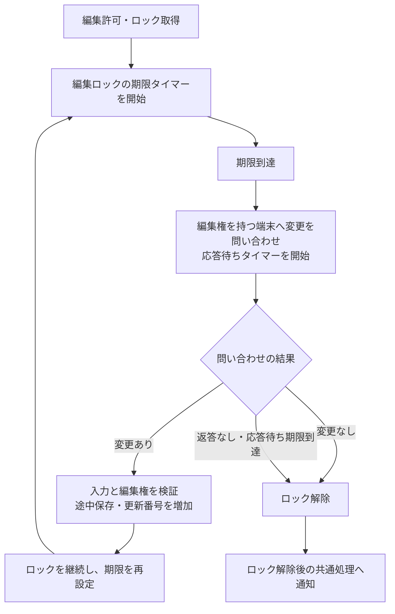
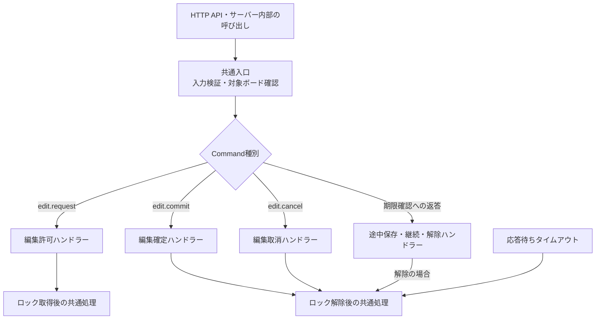
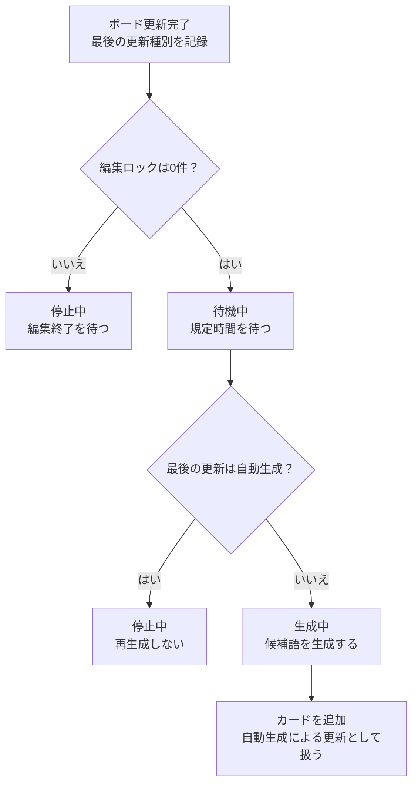

# 編集ロック・Command分割・単語追加の変更構想

この文書は、これから行う変更の設計メモである。実装済みの仕様ではない。
変更を次の3種類に分け、各処理の責務と接続点を整理する。

1. 編集ロックの自動解除・継続システム
2. Command種別ごとの処理分割
3. 編集終了後の単語・候補カード追加処理

関数名・イベント名・定数名は、実装の接続点を説明するための案とする。

## 共通方針

- ブラウザのクリック・キー入力やユーザーの `isIdle` は判定に使わない。
- ハートビートによる無操作判定は廃止する。
- クライアントからの要求とサーバー内部からの呼び出しに、同じ編集ルールを適用する。
- 操作再開は「新しい編集要求をサーバーが許可した時点」とする。
- 編集ロックが0件になった更新、およびロックが0件の状態でのボード更新後に、候補追加の待機を開始する。自動生成による追加も更新として同じ経路を通す。
- ボードごとに最後の更新種別を記録し、最後の更新が自動生成なら待機満了時に生成しない。
- ボード取得や拒否された要求では、待機タイマーと最後の更新情報を変更しない。
- 自動生成後にそれ以外の更新がなければ、再生成しない。独立した「追加済み」フラグではなく、最後の更新種別で制御する。

## 1. 編集ロックの自動解除・継続システム

### 目的

編集を開始した端末が放置・切断されても、ロックが残り続けないようにする。
期限到達時には未反映の変更を確認し、変更があれば途中保存して編集権を継続する。

### 処理の流れ



### ルール

- 編集許可に成功した時点で、カードごとの期限タイマーを開始する。
- 期限到達時は即解除せず、ロックを持つ特定のクライアントへ問い合わせる。
- 変更の有無は、最後にサーバーへ反映したカード内容を基準に確認する。
- 変更がある場合は内容を反映し、更新番号を進める。`editingUser` とロックは保持する。
- 途中保存後は期限タイマーを最初から開始する。候補追加の待機は開始しない。
- 変更がない、または応答待ち時間内に返答がない場合はロックを解除する。
- 通常の編集確定・取消では、期限タイマーと問い合わせの応答待ちを停止する。
- 問い合わせ中も通常の編集確定・取消を受け付け、先に完了した処理を有効とする。
- 解除・更新済みのロックに対する古いタイマーや返答は無視する。
- ロック解除によってボード内のロックが0件になったら、3の候補追加処理へ通知する。

問い合わせと返答には、ボード・カード・ユーザー・端末・ロック・問い合わせを対応付ける識別情報が必要。
`lockId` に加えて、問い合わせIDや期限の世代番号などで遅延した処理を識別する。

### 現在の実装から変更する場所

- `src/server/board-service.ts` のロック管理と `expire()`。
- 現在の「アクセス時に期限切れロックを即解除する」処理を、問い合わせを伴う期限管理へ置き換える。
- GETや通常のCommand処理に旧 `expire()` が残り、問い合わせ前にロックを消さないようにする。
- `src/domain/board-protocol.ts` に、問い合わせと返答の契約を追加する。
- クライアントに、下書きの変更確認・返答・サーバー側解除の反映を追加する。
- サーバーから端末へ問い合わせる通信経路と、返答を受け取る入口を追加する。

これは無操作状態を定期報告するハートビートではなく、編集権の期限確認に限定した通信とする。

### この変更で確認すること

- アクセスがなくても期限到達を検知できる。
- 変更ありなら途中保存とロック継続、変更なし・無応答なら解除になる。
- 別端末や古い問い合わせへの返答ではロックを変更できない。
- 問い合わせと確定・取消が競合しても、二重反映やロックの復活が起きない。

## 2. Command種別ごとの処理分割

### 目的

編集許可・確定・取消に、それぞれ必要なタイマー処理を差し込みやすくする。
HTTP経由でもサーバー内部からでも、同じ処理を通る構造にする。

現在の `editCommand()` は入力の型を確認する関数で、実際の分岐・更新は `executeEdit()` に集約されている。
分割対象は主に `executeEdit()` 内の処理であり、入力検証と操作実行の役割を区別する。

### 分割案



| 処理 | 本体の責務 | 成功後に接続する処理 |
| --- | --- | --- |
| 編集許可 | 競合確認、ロック取得、編集者設定 | ロック期限タイマー開始、候補追加の待機を停止、更新種別を記録 |
| 編集確定 | 編集権確認、内容反映、ロック解除 | ロック関連タイマー停止、残りロック数の確認 |
| 編集取消 | 編集権確認、内容を保持してロック解除 | ロック関連タイマー停止、残りロック数の確認 |
| 期限確認・変更あり | 編集権と内容の検証、途中保存、期限延長 | ロック期限タイマー再開始 |
| 期限確認・変更なし／無応答 | 対象ロックの有効性確認、ロック解除 | ロック関連タイマー停止、残りロック数の確認 |

### 共通化する接続点

- `onLockAcquired`：実際に編集を許可した後に呼ぶ。
- `onLockReleased`：実際にロックを解除した後に呼ぶ。確定・取消・期限切れ解除で共用する。
- `onBoardUpdated`：ボード更新とロック取得・解除など一連の処理が完了した後に呼ぶ。最後の更新種別を記録し、ロックが0件なら候補追加の待機を開始・再設定する。自動生成による追加もこの経路に含める。
- 途中保存はロック解除として通知しない。
- 失敗した要求では、成功後の処理を呼ばない。
- 単純なカード置換関数にはタイマー処理を入れない。カード置換は取得許可・途中保存などでも利用され得るため。

`onLockReleased` と `onBoardUpdated` の役割を重複させず、待機タイマーの設定は更新後の共通経路へ集約する。
途中のカード置換時点ではなく、ロック操作まで完了した状態を見て判断する。

共通処理は、状態変更が成立した経路から確実に1回呼ぶ。
公開関数のラッパーだけに追加すると、APIから `executeEdit()` を直接呼ぶ経路で抜けるため、内部ハンドラー側へ集約する。

### この変更で確認すること

- HTTPとサーバー内部のどちらから呼んでも、同じ検証・タイマー処理が実行される。
- Commandごとに成功・拒否を独立してテストできる。
- ロック取得・解除の通知が抜けたり、二重に呼ばれたりしない。

## 3. 編集終了後の単語・候補カード追加処理

### 目的

ボードの編集がすべて終了した後に、一定時間待って候補カードを追加する。
端末が放置されてもカードが増え続けないよう、最後の更新が自動生成の場合は次の生成を抑止する。
自動生成による追加後も通常どおりタイマーは開始し、タイマー満了時の条件で再生成を防ぐ。

### 開始・停止・実行の条件

| タイミング | 処理 |
| --- | --- |
| 編集確定・取消・自動解除で、最後のロックが解除された | 解除時刻を基準に待機タイマーを開始 |
| ロック解除後も別のロックが残る | 開始しない |
| 新しい編集を許可した | 待機タイマーを停止・破棄し、編集許可による更新を記録 |
| 編集要求を拒否した、またはボードを取得しただけ | 待機・最後の更新情報を変更しない |
| ロックが0件の状態でボードを更新した | 更新種別を記録し、その更新時刻から待機タイマーを開始・再設定 |
| 待機時間が満了し、ロックが0件かつ最後の更新が自動生成ではない | 生成中でないこと等も確認し、候補生成・カード追加を実行 |
| 待機時間が満了したが、最後の更新が自動生成だった | 生成せず停止。同じ更新についてタイマーを再設定しない |
| 自動生成による追加が完了した | 最後の更新を自動生成として記録し、通常の更新と同様に待機タイマーを開始 |

通常の編集では、取消・自動解除も含む最後のロック解除時刻から待機する。
その後、ロックが0件の状態で自動生成などの更新があれば、その更新時刻から待機を数え直す。
待機時間は共通定数で指定し、タイマーと実行状態はボードごとに持つ。
1回とは追加処理の実行回数であり、1回に追加するカード枚数とは別の設定。

### 最後の更新種別の記録

ボードごとに、例えば次の管理情報を持つ。名前と具体的な型は実装時に確定する。

| 情報 | 内容 |
| --- | --- |
| `lastUpdate.kind` | 編集許可・編集確定・編集取消・途中保存・期限切れ解除・自動生成など、更新の原因 |
| `lastUpdate.at` | その更新が成立した時刻 |
| `lastUpdate.revision` | その更新に対応するボードの更新番号 |

更新種別のうち、自動生成を表す値を `auto-generated` とした場合、待機から生成への条件に
`lastUpdate.kind !== 'auto-generated'` を含める。
更新履歴がないボードの初期状態は別途定め、未設定であることだけを理由に生成を始めない。

更新種別はサーバーが実際の処理から決定し、ボード更新と一体で記録する。
クライアントからの自己申告で上書きさせない。
サーバー内部から呼ばれた通常編集と、自動生成によるカード追加は区別する。
候補を複数枚追加する場合も、追加処理の完了後に最後の更新を自動生成として記録し、待機設定は1回行う。
タイマーの開始・満了・生成スキップ自体では、最後の更新種別を変更しない。

### 状態遷移

通常の流れと、編集再開による中断を分けて示す。
図中の更新には、自動生成によるカード追加も含む。

**通常の流れ：更新 → 待機 → 生成するか判定**



カード追加後は、図の先頭の「ボード更新完了」へ戻る。
再び規定時間を待つが、最後の更新が自動生成なので、次は「再生成しない」で停止する。
図の長い戻り矢印は省略している。

**途中で新しい処理が入った場合**

| 現在の状態 | 起きたこと | 次の状態・処理 |
| --- | --- | --- |
| 待機中 | 新しい編集を許可 | 停止中へ。タイマーを停止・破棄する |
| 待機中 | ロック0件のまま別の更新が完了 | 待機中のまま。更新種別を記録し、待機時間を最初から数え直す |
| 生成中 | 新しい編集を許可 | 停止中へ。生成結果を無効にし、カードを追加しない |

タイマー満了時と生成結果の反映直前には、ロック・更新番号・処理の世代も再確認する。
表の中断条件が起きていた場合、古い処理を続行しない。

### 処理を分ける

1. 待機の管理：最後の更新種別・時刻、タイマー、生成中状態を管理する。
2. 単語の生成：確定済みボードのコピーを渡し、候補語を得る。
3. カードの追加：候補語をカード化し、ボード・更新番号・最後の更新種別を更新する。通常の更新後の経路で次の待機を開始する。
4. 結果の通知：生成後のボードをクライアントが取得・反映できるようにする。

待機管理と、AI等による実際の単語生成を分け、生成サービスを差し替え可能にする。
現在の `src/server/ai-service.ts` はダミー生成なので、その位置付けを明示する。

### 重複・競合の防止

- 生成開始前に生成中状態を設定し、同じ待機期間の重複実行を防ぐ。
- タイマーの世代番号等で、停止済みタイマーのコールバックを無効化する。
- 非同期生成の開始時にはボードのコピー・更新番号・編集期間の識別情報を保持する。
- 完了時にもロックや新しい編集の開始を確認し、古い生成結果を適用しない。
- 自動生成による追加後もタイマーを開始するが、満了時に最後の更新が自動生成なら生成しない。
- 独立した追加済みフラグは持たず、最後の更新種別を判定の基準とする。生成中状態は重複起動防止のため別途持つ。
- 判定に使うのはタイマー開始時の更新種別のコピーではなく、満了時点の最新状態とする。

### 不要になる既存処理

- `src/hooks/useIdleTimer.ts`
- `src/hooks/useIdleHeartbeat.ts`
- 画面からのアイドル監視の呼び出し
- `idle.heartbeat` Commandと、その通信処理
- `clientIdleStates`、`areAllClientsIdle()` など、端末のアイドル状態によるサーバー判定
- ハートビート受信直後に候補生成する処理

### この変更で確認すること

- 最後のロック解除から規定時間で1回だけ追加される。
- 自動生成による追加も通常の更新後処理を通り、最後の更新種別と待機タイマーが設定される。
- そのタイマーの満了時は自動生成が最後の更新なので、再生成せず停止する。
- 待機中に編集を許可すると追加されず、次の編集終了時から時間を数え直す。
- 新たな編集許可・確定・取消・期限切れ解除では、実際の更新種別を記録し直す。
- 取得・拒否された要求・端末の放置では、再追加されない。
- ボードごとの待機・生成状態が混ざらない。
- 生成中の新しい編集と競合しても、古い候補を追加しない。
- 追加完了をクライアントが確認できる。

## 3種類の変更の接続関係

```text
Command種別ごとのハンドラー
  ├ 編集許可
  │   ├ ロック期限タイマー開始                 … 変更1
  │   └ 候補追加の待機停止・更新種別記録       … 変更3
  ├ 編集確定・取消
  │   └ 共通のロック解除処理
  └ 期限確認への返答・応答タイムアウト         … 変更1
      ├ 変更あり：途中保存・ロック継続
      └ 変更なし／無応答：共通のロック解除処理

共通のロック解除処理
  ├ ロック関連タイマーの後始末                … 変更1
  └ 更新完了の共通処理へ通知                  … 変更2・3

更新完了の共通処理（自動生成による追加も含む）
  ├ 最後の更新種別・時刻・更新番号を記録      … 変更3
  └ ボードのロックが0件なら候補追加待機を開始  … 変更3

候補追加の待機満了
  ├ 最後の更新が自動生成：生成せず停止        … 変更3
  └ それ以外：他の条件も確認して生成          … 変更3

上記の処理を差し込みやすい形に分割する        … 変更2
```

## 実装前に決める事項

- ロック期限、問い合わせ応答待ち、候補追加待機の具体的な時間。
  定数名の案は `EDIT_LOCK_TTL_MS`、`EDIT_REPLY_TIMEOUT_MS`、`WORD_ADDITION_DELAY_MS`。
- 問い合わせ・返答・ロック解除・カード追加完了の通信方式とイベント形式。
- 期限確認の返答が不正だった場合の扱い。
- 生成失敗時の再試行方針。成功していない場合の再試行と、成功後の再生成抑止を区別する。
- 1回に追加する単語数とカードの配置方法。
- 起動直後や再起動後の、ロック・タイマー・最後の更新情報の復元方法。

単一プロセスのメモリ管理から始める場合も、タイマーがプロセス終了で失われることを前提として明記する。
