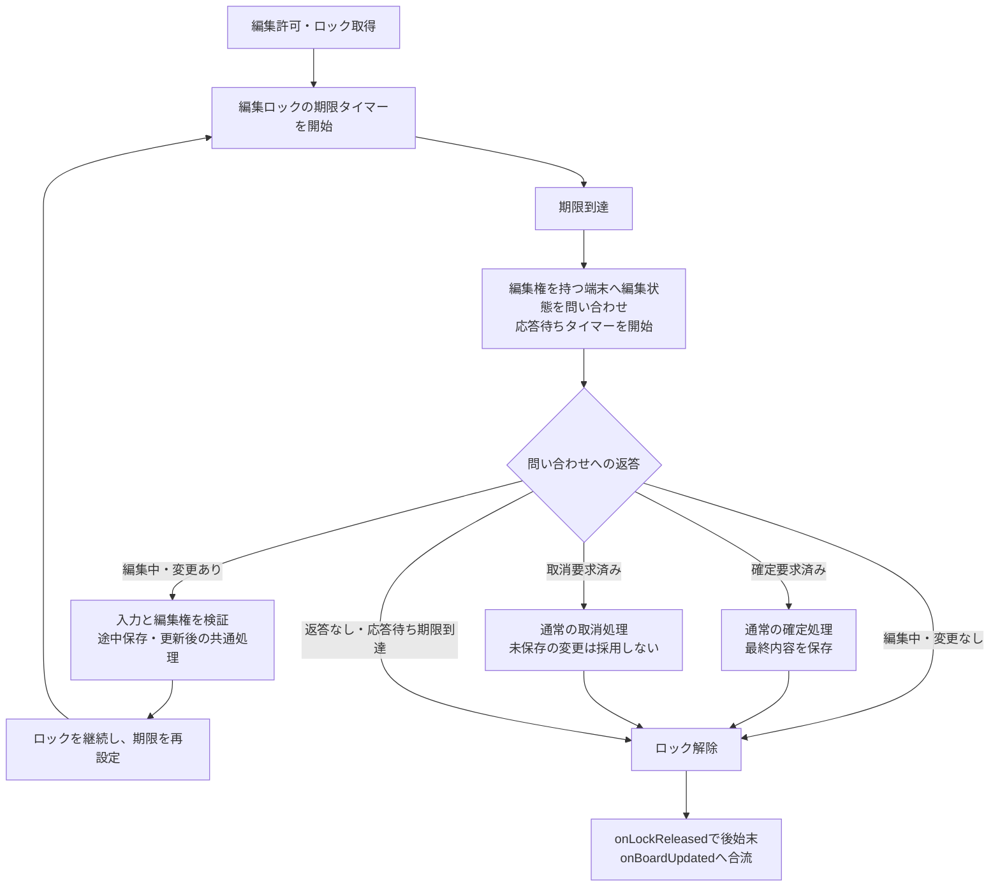
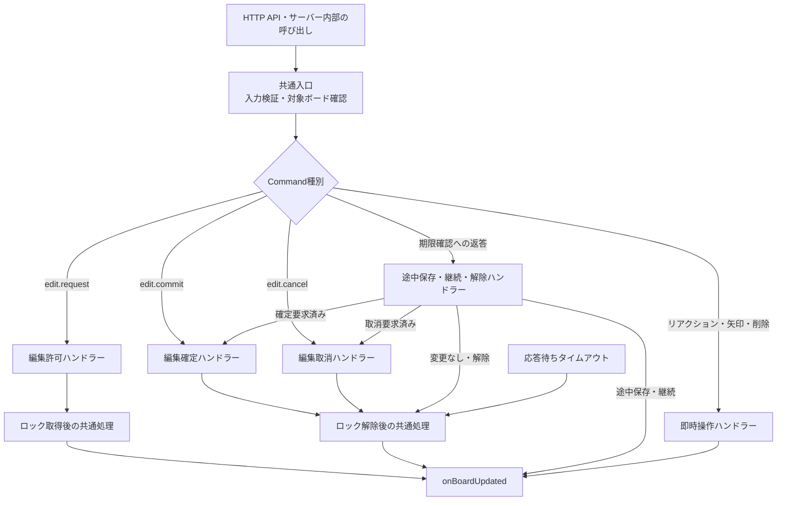
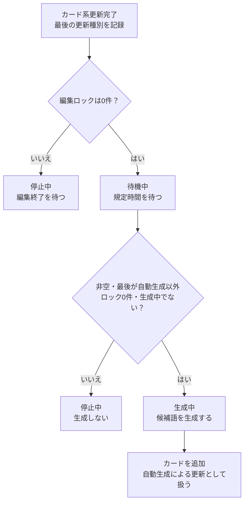

# 編集ロック・Command分割・単語追加の変更構想

この文書は、編集ライフサイクルの設計と実装方針をまとめたものである。
以下の3種類の変更を実装済み。具体的な設定値・通信・運用上の制約は末尾の「実装で採用した事項」を参照。
変更を次の3種類に分け、各処理の責務と接続点を整理する。

1. 編集ロックの自動解除・継続システム
2. Command種別ごとの処理分割
3. 編集終了後の単語・候補カード追加処理

関数名・イベント名・定数名は、実装の接続点を説明するための案とする。
2026年10月25日のフロント統合の議論を反映する。共通型・削除・移動・SSE配信の方針は [frontend-merge-plan.md](./frontend-merge-plan.md) を参照する。ここでは、それらの操作がロック・問い合わせ・自動追加にどう接続するかを扱う。

## 共通方針

- ブラウザのクリック・キー入力やユーザーの `isIdle` は判定に使わない。
- ハートビートによる無操作判定は廃止する。
- クライアントからの要求とサーバー内部からの呼び出しに、同じ編集ルールを適用する。
- 継続するカード編集の再開は「新しい編集要求をサーバーが許可した時点」とする。リアクション・矢印・削除等の即時操作は、サーバーでの反映確定を編集開始と最終編集が同時に成立した時点として扱う。
- 編集ロックが0件になった更新、およびロックが0件の状態でのカード系更新後に、候補追加の待機を開始する。自動生成による追加も同じ経路を通す。Board.timerの更新では待機を変更しない。
- ボードごとに最後のカード系更新種別を記録し、最後の更新が自動生成なら待機満了時に生成しない。以下の `lastUpdate` はこの編集・生成に関する更新情報を指す。
- ボード取得や拒否された要求では、待機タイマーと最後の更新情報を変更しない。
- 自動生成後にそれ以外の更新がなければ、再生成しない。独立した「追加済み」フラグではなく、最後の更新種別で制御する。
- 自動生成は生成に使える本文があることも条件にする。`isEmpty` はカード0枚ではなく、全カードの本文が空白・改行だけの状態も含む。全消去後や空カード追加後も待機は設定し、満了時に入力がなければ生成せず停止する。
- 一括操作は全対象の状態を確定してから更新後の共通処理を1回だけ呼ぶ。カードごとの途中状態で待機設定・配信を行わない。

## 1. 編集ロックの自動解除・継続システム

### 目的

編集を開始した端末が放置・切断されても、ロックが残り続けないようにする。
期限到達時には、クライアントの編集状態と未反映の変更を確認する。編集中なら途中保存・継続または解除を行い、確定・取消要求済みなら通常の終了処理へ合流する。

### 処理の流れ



### ルール

- 編集許可に成功した時点で、貸し出し単位のlockIdに対して期限タイマーを開始する。
- 期限到達時は即解除せず、ロックを持つ特定のクライアントへ問い合わせる。
- 変更の有無は、最後にサーバーへ反映したカード内容を基準に確認する。
- 編集中で対象の1枚でも変更がある場合は途中保存し、更新後の共通処理で更新番号を進める。全対象の `editingUser` と貸し出しは保持する。
- 途中保存後は期限タイマーを最初から開始する。候補追加の待機は開始しない。
- 編集中で全対象に変更がない、または応答待ち時間内に返答がない場合は貸し出し全体を解除する。
- 確定リクエスト済みと返答されたら、最終内容と編集権を検証し、通常の確定ハンドラーで保存・解除する。
- キャンセルリクエスト済みと返答されたら、通常の取消ハンドラーで未保存の変更を反映せず解除する。途中保存済みの内容は巻き戻さない。
- 通常の編集確定・取消では、期限タイマーと問い合わせの応答待ちを停止する。
- 問い合わせ中も通常の編集確定・取消を受け付ける。通常要求と問い合わせ返答のどちらが先でも、編集終了は一度だけ確定する。
- 解除・更新済みのロックに対する古いタイマーや返答は無視する。
- ロック解除によってボード内のロックが0件になったら、3の候補追加処理へ通知する。

問い合わせと返答には、ボード・カード・ユーザー・端末・ロック・問い合わせを対応付ける識別情報が必要。
`lockId` に加えて、問い合わせIDや期限の世代番号などで遅延した処理を識別する。

### 通常要求が届かなかった場合の回収

通常はクライアントの確定・取消要求で終了する。問い合わせは要求が届かずロックが残った場合の回収経路であり、ドラッグだけでなく通常のWordCard・BlockCardにも共用する。
問い合わせから終了する場合も、対象ロックと `editingUser` の解除 → `onLockReleased` による期限・応答待ちの後始末 → `onBoardUpdated` → 全端末への通知、の順序へ合流する。

HTTPの応答期限を過ぎたことだけで、拒否・解除と決めつけない。クライアントは確定／取消要求済みの状態・最終内容・対象ロックとの対応を保持し、問い合わせに返せるようにする。
完全切断では応答待ち期限による解除を使い、再接続時に確定状態へ同期する。確定が成功して応答だけが届かなかった場合は、ロックが既にないため問い合わせは発生しない。
通信契約として、同じclientId・requestId・同じ内容の再送には前回の結果を返し、二重実行しない方針が決まっている。同じID・異なる内容は拒否しサーバーでエラーログを出す。要求結果の保持期間・保存先、専用再照会API、自動再送の頻度・回数は別途決める。
再送へ結果を返すこと自体では、ロック取得・解除・onBoardUpdated・自動追加の待機を再実行しない。

### 複数カードを同時に扱う場合

複数選択の移動は、全対象のロック取得・位置確定・解除を一括して扱う。1枚でも取得できなければ取得全体を拒否し、部分的にロックを残さない。
単一・複数とも1回の貸し出しに1つの `lockId` を発行し、対象cardIds・userId・clientId・expiresAtをサーバーの台帳に持つ。カードIDからlockIdへの索引も持ち、別の必須セッションIDは増やさない。
問い合わせ・途中保存・取消・期限解除をこの貸し出し単位に揃える。1枚でも変更があれば途中保存して全対象を継続し、全対象が変更なしなら全対象を解除する。台帳の具体的な型名・問い合わせの形式は後続で決める。
`onLockAcquired`・継続処理・`onLockReleased` も貸し出し単位で接続し、対象カードと索引の後始末後、更新後の共通処理と配信を操作全体で1回にまとめる。

### 現在の実装から変更する場所

- `src/server/board-service.ts` のロック管理と `expire()`。
- 現在の「アクセス時に期限切れロックを即解除する」処理を、問い合わせを伴う期限管理へ置き換える。
- GETや通常のCommand処理に旧 `expire()` が残り、問い合わせ前にロックを消さないようにする。
- `src/domain/board-protocol.ts` に、問い合わせと返答の契約を追加する。
- クライアントに、編集中／確定要求済み／キャンセル要求済みと変更内容の返答・サーバー側解除の反映を追加する。HTTP失敗時に編集状態を即時破棄する処理も見直す。
- サーバーから端末へ問い合わせる通信経路と、返答を受け取る入口を追加する。

これは無操作状態を定期報告するハートビートではなく、編集権の期限確認に限定した通信とする。

### この変更で確認すること

- アクセスがなくても期限到達を検知できる。
- 編集中・変更ありなら途中保存とロック継続、編集中・変更なしまたは無応答なら解除になる。
- 別端末や古い問い合わせへの返答ではロックを変更できない。
- 問い合わせと確定・取消が競合しても、二重反映やロックの復活が起きない。
- 確定／取消要求済みの返答が通常ハンドラーと同じ解除・後始末・更新処理を通る。
- 複数対象で一部だけの保存・解除や、共通処理の二重実行が起きない。

## 2. Command種別ごとの処理分割

### 目的

編集許可・確定・取消に、それぞれ必要なタイマー処理を差し込みやすくする。
HTTP経由でもサーバー内部からでも、同じ処理を通る構造にする。

現在の `editCommand()` は入力の型を確認する関数で、実際の分岐・更新は `executeEdit()` に集約されている。
分割対象は主に `executeEdit()` 内の処理であり、入力検証と操作実行の役割を区別する。
`EditCommand` は現在「取得・ハートビート以外」という除外型なので、操作追加時にはコマンド群を明示的に分ける。新しい要求を既存の確定・取消へ流さず、種類ごとに検証・実行する。

### 分割案



| 処理 | 本体の責務 | 成功後に接続する処理 |
| --- | --- | --- |
| 編集許可 | 競合確認、ロック取得、編集者設定 | ロック期限タイマー開始、候補追加の待機を停止、更新種別を記録 |
| 編集確定 | 編集権確認、内容反映、ロック解除 | ロック関連タイマー停止、残りロック数の確認 |
| 編集取消 | 編集権確認、内容を保持してロック解除 | ロック関連タイマー停止、残りロック数の確認 |
| 期限確認・編集中・変更あり | 編集権と内容の検証、途中保存、期限延長 | ロック期限タイマー再開始、ロックを保持したまま更新後処理 |
| 期限確認・確定要求済み | 通常の確定ハンドラーへ合流 | ロック解除後の共通処理、更新後処理 |
| 期限確認・取消要求済み | 通常の取消ハンドラーへ合流 | ロック解除後の共通処理、更新後処理 |
| 期限確認・編集中・変更なし／無応答 | 対象ロックの有効性確認、ロック解除 | ロック関連タイマー停止、残りロック数の確認 |
| リアクション・矢印・削除 | 種類別に検証し、即時に反映。削除対象のカードが編集中なら拒否 | ロックを作らず更新後の共通処理 |
| 空カード追加・サンプル復元 | ロックなしで追加、またはロック0件を確認してサンプルへ一括置換 | カード系の更新後処理。本文入力は別途編集許可を取得 |
| 共有タイマー | Board.timerの専用コマンドで反映 | revisionと配信だけ更新し、編集の最終更新情報・自動追加待機は維持 |

### 共通化する接続点

- `onLockAcquired`：実際に編集を許可した後に呼び、対象ロックの期限管理を開始する。
- ロック継続時の処理：途中保存後に期限と問い合わせ待ちを再設定する。解除とは区別し、関数名は後続で決める。
- `onLockReleased`：実際にロックを解除した後に呼び、期限・問い合わせ待ちのタイマーを停止し、古い問い合わせを無効化する。通常と問い合わせ経由の確定・取消、期限切れ解除で共用する。
- `onBoardUpdated`：操作全体の影響ID一覧と更新種別を受け取り、全体revisionと確定状態の配信を管理する。カード系更新では最後の更新情報も記録し、待機を停止・リセットしてロック0件なら開始する。共有タイマー更新では最後のカード系更新情報・自動追加待機を変更しない。
- 途中保存はロック解除として通知しない。
- 失敗した要求では、成功後の処理を呼ばない。
- 取得・実際の変更がない即時要求でも呼ばない。ただし、内容が同じでもロック取得・解除は状態変更として扱う。
- 単純なカード置換関数にはタイマー処理を入れない。カード置換は取得許可・途中保存などでも利用され得るため。

`onLockReleased` と `onBoardUpdated` の役割を重複させず、待機タイマーの設定は更新後の共通経路へ集約する。
途中のカード置換時点ではなく、ロック操作まで完了した状態を見て判断する。

`onBoardUpdated` は状態変更が成立した経路から、操作全体につき1回呼ぶ。影響IDには、直接変更・削除した対象、参照除去で更新したBlockCard、連動して削除した矢印を含め、IDの内容で重複を除く。
複数対象も1件の貸し出しとして取得・解除の後始末を行い、その後で `onBoardUpdated` へ1回合流する。カード置換のたびにrevisionを増やす現在の構造は見直す。
公開関数のラッパーだけに追加すると、APIから `executeEdit()` を直接呼ぶ経路で抜けるため、内部ハンドラー側へ集約する。

### この変更で確認すること

- HTTPとサーバー内部のどちらから呼んでも、同じ検証・タイマー処理が実行される。
- Commandごとに成功・拒否を独立してテストできる。
- ロック取得・解除の通知が抜けたり、二重に呼ばれたりしない。

## 3. 編集終了後の単語・候補カード追加処理

### 目的

ボードの編集がすべて終了した後に、一定時間待って候補カードを追加する。
端末が放置されてもカードが増え続けないよう、最後の更新が自動生成の場合は次の生成を抑止する。
自動生成による追加後も通常どおりタイマーは開始し、タイマー満了時の条件で再生成を防ぐ。

### 開始・停止・実行の条件

| タイミング | 処理 |
| --- | --- |
| 編集確定・取消・自動解除で、最後のロックが解除された | 解除時刻を基準に待機タイマーを開始 |
| ロック解除後も別のロックが残る | 開始しない |
| 新しい編集を許可した | 待機タイマーを停止・破棄し、編集許可による更新を記録 |
| リアクション・矢印・削除の即時操作が確定した | ユーザー更新として記録し、待機タイマーを停止・リセット。ロック0件ならその確定時点から再スタート |
| 編集要求を拒否した、またはボードを取得しただけ | 待機・最後の更新情報を変更しない |
| ロックが0件の状態でカード系の状態を更新した | 更新種別を記録し、その更新時刻から待機タイマーを開始・再設定 |
| 共有タイマーを更新した | ボードのrevisionと配信は更新するが、編集の最終更新情報・自動追加待機は変更しない |
| 待機時間が満了し、ボードが空でなく、ロック0件かつ最後の更新が自動生成ではない | 生成中でないこと等も確認し、候補生成・カード追加を実行 |
| 待機時間が満了したが、ボードが空、または最後の更新が自動生成だった | 生成せず停止。同じ更新についてタイマーを再設定しない |
| 自動生成による追加が完了した | 最後の更新を自動生成として記録し、通常の更新と同様に待機タイマーを開始 |

通常の編集では、取消・自動解除も含む最後のロック解除時刻から待機する。
その後、ロックが0件の状態で自動生成などの更新があれば、その更新時刻から待機を数え直す。
待機時間は共通定数で指定し、タイマーと実行状態はボードごとに持つ。
1回とは追加処理の実行回数であり、1回に追加するカード枚数とは別の設定。
単一削除・範囲削除・全消去も1操作の確定後に待機を設定する。全消去後は満了時の空判定で生成を抑止する。空の全消去・拒否・実際の変更がない重複操作は待機を変えない。

### 満了時のAND条件

`isEmpty(board)` は、WordCard・BlockCardの本文に生成入力として使える文字がないこととする。カード枚数ではなく、満了時点の本文で判定する。

```ts
function isEmpty(board: Board): boolean {
  return board.cards.every(card => card.text.trim().length === 0);
}
```

```ts
lastUpdate !== undefined &&
!isEmpty(board) &&
lastUpdate.kind !== "auto-generated" &&
locks.size === 0 &&
!isGenerating
```

更新履歴がないことだけを理由に生成を始めない。手動生成も同じ本文の有無を確認する。
全消去の変更なし判定は別であり、空本文のカードがある場合も実際に削除する。
結果反映前には、生成に関係する更新・ロック・世代を再確認する。共有タイマーの更新だけで生成を無効化せず、全体revisionとは別の有効性判定用情報を用意する。名称・型は未確定。

### 最後の更新種別の記録

ボードごとに、例えば次の管理情報を持つ。名前と具体的な型は実装時に確定する。

| 情報 | 内容 |
| --- | --- |
| `lastUpdate.kind` | 編集許可・確定・取消・途中保存・期限切れ解除・リアクション・矢印・削除・自動生成など、更新の原因 |
| `lastUpdate.at` | その更新が成立した時刻 |
| `lastUpdate.revision` | その更新に対応するボードの更新番号 |

更新種別のうち、自動生成を表す値を `auto-generated` とした場合、待機から生成への条件に
`lastUpdate.kind !== 'auto-generated'` を含める。
更新履歴がないボードの初期状態は別途定め、未設定であることだけを理由に生成を始めない。

更新種別はサーバーが実際の処理から決定し、ボード更新と一体で記録する。即時操作は編集許可・確定の2更新に分けず、その操作の種別で1回記録する。
クライアントからの自己申告で上書きさせない。
サーバー内部から呼ばれた通常編集と、自動生成によるカード追加は区別する。
候補を複数枚追加する場合も、追加処理の完了後に最後の更新を自動生成として記録し、待機設定は1回行う。
タイマーの開始・満了・生成スキップ自体では、最後の更新種別を変更しない。

### 状態遷移

通常の流れと、編集再開による中断を分けて示す。
図中の更新には、自動生成によるカード追加も含む。

**通常の流れ：更新 → 待機 → 生成するか判定**



カード追加後は、図の先頭の「ボード更新完了」へ戻る。
再び規定時間を待つが、最後の更新が自動生成なので、次は「再生成しない」で停止する。
図の長い戻り矢印は省略している。

**途中で新しい処理が入った場合**

| 現在の状態 | 起きたこと | 次の状態・処理 |
| --- | --- | --- |
| 待機中 | 新しい編集を許可 | 停止中へ。タイマーを停止・破棄する |
| 待機中 | ロック0件のまま別の更新が完了 | 待機中のまま。更新種別を記録し、待機時間を最初から数え直す |
| 生成中 | 新しい編集を許可 | 停止中へ。生成結果を無効にし、カードを追加しない |
| 生成中 | リアクション・矢印・削除等の更新が確定 | 古い生成結果は適用せず、ロック0件なら更新後から待機し直す |
| 待機中・生成中 | 共有タイマーの更新 | 待機・生成の有効性を維持する |

タイマー満了時と生成結果の反映直前には、ロック・生成に関係する更新・処理の世代も再確認する。
表の中断条件が起きていた場合、古い処理を続行しない。

### 処理を分ける

1. 待機の管理：最後の更新種別・時刻、タイマー、生成中状態を管理する。
2. 単語の生成：確定済みボードのコピーを渡し、候補語を得る。
3. カードの追加：候補語をカード化し、ボード・更新番号・最後の更新種別を更新する。通常の更新後の経路で次の待機を開始する。
4. 結果の通知：生成後のボードをクライアントが取得・反映できるようにする。

待機管理と、AI等による実際の単語生成を分け、生成サービスを差し替え可能にする。
現在の `src/server/ai-service.ts` はダミー生成なので、その位置付けを明示する。
手動・時限式は関連性を受け取る同じ生成・配置関数を共用する。手動は選択したlow・mid・high、時限式はmid固定を渡し、候補生成にも指定を引き継ぐ。
要求の再送で処理中の生成を再起動しないよう、要求IDによる処理中状態の記録も共通入口で行う。
生成1回をgenerationIdで識別し、開始・カード追加完了・失敗・競合破棄をサーバーから全端末へ通知する。初期取得・再接続でも現在の生成状態を渡し、クライアントの表示を固定時間で解除しない。
開始・失敗・破棄の通知だけではonBoardUpdated・Boardのrevision・編集の最終更新情報・待機を更新しない。カード追加が確定した場合に通常の更新後処理を通す。競合原因の編集操作の更新処理は別途行う。

### 重複・競合の防止

- 生成開始前に生成中状態を設定し、同じ待機期間の重複実行を防ぐ。
- タイマーの世代番号等で、停止済みタイマーのコールバックを無効化する。
- 非同期生成の開始時にはボードのコピー・生成に関係する更新情報・編集期間の識別情報を保持する。全体revisionの変化だけで結果を破棄しない。
- 完了時にもロックや新しい編集の開始を確認し、古い生成結果を適用しない。
- 自動生成による追加後もタイマーを開始するが、満了時に最後の更新が自動生成なら生成しない。
- 独立した追加済みフラグは持たず、最後の更新種別を判定の基準とする。生成中状態は重複起動防止のため別途持つ。
- 判定に使うのはタイマー開始時の更新種別のコピーではなく、満了時点の最新状態とする。
- 生成結果は最新Boardへ追加し、参照した古いBoard全体で置換しない。生成中に変更された共有タイマーを巻き戻さない。

### 不要になる既存処理

- `src/hooks/useIdleTimer.ts`
- `src/hooks/useIdleHeartbeat.ts`
- 画面からのアイドル監視の呼び出し
- `idle.heartbeat` Commandと、その通信処理
- `clientIdleStates`、`areAllClientsIdle()` など、端末のアイドル状態によるサーバー判定
- ハートビート受信直後に候補生成する処理

### この変更で確認すること

- 最後のロック解除から規定時間で1回だけ追加される。
- 自動生成による追加も通常の更新後処理を通り、最後の更新種別と待機タイマーが設定される。
- そのタイマーの満了時は自動生成が最後の更新なので、再生成せず停止する。
- 待機中に編集を許可すると追加されず、次の編集終了時から時間を数え直す。
- 新たな編集許可・確定・取消・期限切れ解除では、実際の更新種別を記録し直す。
- 取得・拒否された要求・端末の放置では、再追加されない。
- ボードごとの待機・生成状態が混ざらない。
- 全消去後、空カードだけ、空白・改行だけのボードでは生成せず、同じ更新のまま待機を繰り返さない。
- リアクション・矢印・削除の更新でも待機をリセットし、他のロックが残る場合は開始しない。
- 生成中の新しい編集と競合しても、古い候補を追加しない。
- 追加確定後のボード・revision・生成カードID一覧をSSEで全端末へ届ける。画面外案内は端末内で管理し、配信・初期化の詳細はmerge planに従う。
- 生成失敗・競合破棄でも進行表示が終わり、古いgenerationIdの通知で新しい生成中状態を壊さない。

## 3種類の変更の接続関係

```text
Command種別ごとのハンドラー
  ├ 編集許可
  │   ├ ロック期限タイマー開始                 … 変更1
  │   └ 候補追加の待機停止・更新種別記録       … 変更3
  ├ 編集確定・取消
  │   └ 共通のロック解除処理
  └ 期限確認への返答・応答タイムアウト         … 変更1
      ├ 編集中・変更あり：途中保存・ロック継続
      ├ 確定／取消要求済み：通常の終了処理
      └ 編集中・変更なし／無応答：共通のロック解除処理

リアクション・矢印・削除の即時操作
  └ 検証・一括反映後、更新完了の共通処理へ

共通のロック解除処理
  ├ ロック関連タイマーの後始末                … 変更1
  └ 更新完了の共通処理へ通知                  … 変更2・3

カード系更新完了の共通処理（操作全体で1回）
  ├ 影響した複数BoardObjectId・更新種別を受け取る
  ├ 最後の更新種別・時刻・更新番号を記録      … 変更3
  ├ 既存の候補追加待機を停止・リセット
  └ ボードのロックが0件なら候補追加待機を開始  … 変更3

共有タイマーの更新後処理
  └ 全体revision・配信のみ。編集の最終更新情報・待機を維持

共有タイマーの0秒到達
  └ 停止状態への遷移確定時、空のonTimerFinishedを1回呼ぶ
      通常の停止・リセット・端末の表示更新では呼ばない

候補追加の待機満了
  ├ ボードが空／最後の更新が自動生成：生成せず停止
  └ それ以外：他の条件も確認して生成          … 変更3

上記の処理を差し込みやすい形に分割する        … 変更2
```

## 実装で採用した事項

- ロック期限、問い合わせ応答待ち、候補追加待機の具体的な時間。
  定数名の案は `EDIT_LOCK_TTL_MS`、`EDIT_REPLY_TIMEOUT_MS`、`WORD_ADDITION_DELAY_MS`。
- 問い合わせ・返答・ロック解除の具体的なイベント形式。操作要求はHTTP、更新・生成結果通知はSSEを使う方針とし、問い合わせの対象・世代の検証方法を詰める。
- 貸し出し台帳・カードID索引の具体的な型、lockIdと要求・問い合わせの対応方法。
- 通信タイムアウト中・再接続時に保持するクライアント状態、要求結果の保持期間・保存先、専用再照会API、自動再送の頻度・回数。
- 期限確認の返答が不正だった場合の扱い。
- 生成失敗時の再試行方針。成功していない場合の再試行と、成功後の再生成抑止を区別する。
- 1回に追加する単語数とカードの配置方法。
- 起動直後や再起動後の、ロック・タイマー・最後の更新情報の復元方法。
- 即時操作が生成入力に影響しない場合、進行中の生成結果を維持する最適化を行うか。待機のリセットとは別に検討する。
- 共有タイマー更新から独立した、生成に関係する更新情報の名称・型と更新方法。

単一プロセスのメモリ管理から始める場合も、タイマーがプロセス終了で失われることを前提として明記する。
