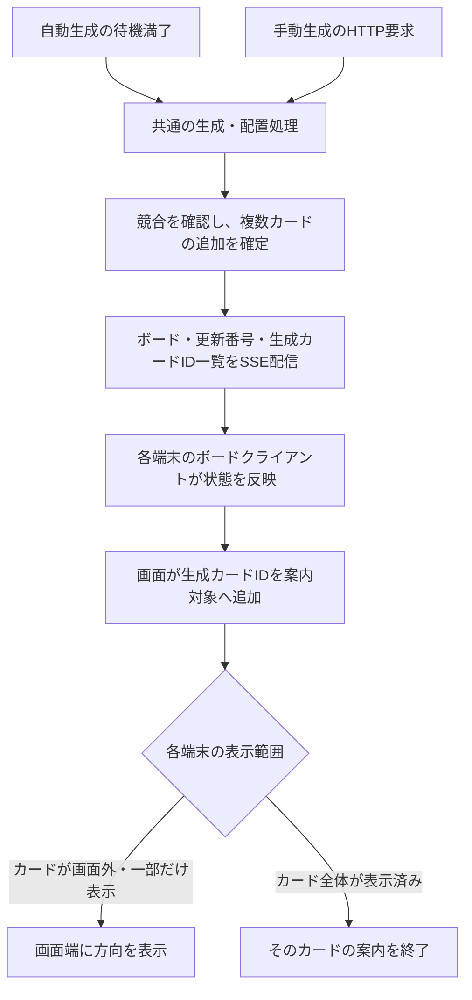

# フロント統合・共通モデルの変更計画

この文書は、Adjustのフロントの設計変更を共通モデル・バックエンドへ取り込むための設計メモである。2026年10月25日までの議論をまとめ、合意した方針と検討事項を分けて記録する。合意事項の統合実装を行った。本文の型案・未確定事項は議論時点の記録として残し、実装で採用したAPI・寸法・通信・制約は [implementation.md](./implementation.md) を参照する。

## 1. 目的と合意した方針

従来の付箋を **WordCard** と呼び、大きなカードである **BlockCard** を追加する。
共通項目は共有し、BlockCard専用の項目をWordCardに要求しない型に分ける。

| 項目 | WordCard | BlockCard |
| --- | --- | --- |
| `cardId` | `CardId` | `CardId` |
| `cardKind` | 種類を判別する値 | 種類を判別する値 |
| `shape` | `{ width, height }` | `{ width, height }` |
| `position` | `{ x, y, z }` | `{ x, y, z }` |
| `color` | 共通 | 共通 |
| `font` | 共通 | 共通 |
| `text` | 共通の本文 | 共通の本文 |
| `editingUser` | 共通・省略可 | 共通・省略可 |
| `relatedIds` | 持たない | `readonly CardId[]` |
| `reactions` | 持たない | `readonly CardReaction[]` |
| `summary` | 持たない | 持たない |

- `shape` は従来の文字列から、幅と高さを持つオブジェクトへ変更する。
- `font` は両方のカードで保持する。既存の共通Cardにはあるが、フロントの独自の送信用型にはないため、両者を揃える。
- 本文は両方とも `text` とし、BlockCardの `summary` は廃止する。
- `relatedIds` と `reactions` はBlockCardだけに定義する。
- ボード上のオブジェクトのIDは、UUIDと種別を組み合わせた `BoardObjectId` とする。`type` と `uuid` の両方で同一性を判定する。
- リアクションの定義と、カードに誰がどのリアクションを付けたかを分離する。
- カード間の矢印は関連付けとは独立して保持し、接続位置は方角を使った `Anchor` で表す。
- 手動AI生成は、フロントで1枚作る機能ではなく、サーバーの既存の複数単語生成・配置処理を呼び出す機能とする。
- 自動・手動生成の結果は、生成したカードID一覧とともにSSEで同じボードの全端末へ配信する。画面外案内は各端末の表示範囲で判定する。
- リアクションと矢印は、クライアントが操作内容を確定して専用要求を即時送信する。カード編集のロック・下書きとは別経路にし、サーバーで反映を確定する。
- 更新後の共通処理へ両経路を合流させ、カード系の即時操作でも自動追加の待機タイマーを停止・リセットする。編集ロックが0件なら、その確定時点から再スタートする。共有タイマーの操作はこの待機に影響させない。
- 単一削除・範囲削除・全消去は、削除対象のカードに編集ロックがあれば全体を拒否し、実行する場合は参照・接続矢印の除去も一括して確定する。
- `onBoardUpdated` は、1回の操作で影響を受けた複数の `BoardObjectId` を扱う。一括操作でもrevisionの更新・待機設定・更新通知は1回にまとめる。
- 単一・複数カードの移動は、許可待ちから本人の画面で仮移動する。拒否されたら最新の確定位置へ戻し、保存はサーバーの編集許可後に行う。
- 編集期限の問い合わせには、編集中・確定要求済み・キャンセル要求済みの状態を返す。後二者は通常の確定・取消と同じ経路で保存・解除する。
- 新規作成は空カードをロックなしで追加・共有する。入力欄での編集開始は、作成とは別の編集許可要求で扱う。
- 自動・手動生成の入力条件として、空白・改行以外の本文があることを要求する。`isEmpty` はカード枚数でなく、生成に使える本文がないことを表す。
- 本文は入力欄で編集開始、空白キャンバスへのタップまたはCtrl／⌘＋Enterで確定、Enterで改行、Escapeで取消とする。フォーカスが外れただけでは確定しない。関連先選択中のEscapeは選択だけを中止する。キー割り当ての変更設定は余裕があれば実装する追加機能とする。
- UIはAdjustの `page.tsx` を基準に、共通型・保存・ロック・通知を本計画へ接続する。
- 共有タイマーは用途を限定せず `Board.timer` に所属させる。サンプル復元は残し、全消去と同じ拒否条件でカード・矢印を一括置換し、共有タイマーは保持する。
- 単一・複数編集の貸し出し単位に1つの `lockId` を発行する。対象カード一覧、借りたユーザー・端末、有効期限をサーバーの台帳に保持する。
- Reactionはアプリ共通の固定定義とし、フロントとサーバーが同じ一覧を参照する。動的追加・ボード固有のカスタム定義は設けない。
- リアクションはユーザー・種類ごとに1件までで、自分の付与だけを取り消せる。矢印は自己接続・同一端点とAnchorの重複を禁止し、逆向き・循環・異なるAnchorを許可する。
- 共有タイマーは初期5分・停止中のカウントダウンとする。0秒で停止し、空の `onTimerFinished` フックをサーバーで1回呼べるようにする。
- 手動と時限式のAI生成は、関連性を引数に取る同じ生成・配置関数を使う。手動は選択値、時限式は中固定とする。
- 同じクライアント・要求IDの再送は二重実行せず結果を再利用する。同じ要求IDで内容が異なれば拒否し、サーバーでエラーログを出す。
- Delete／Backspaceによる削除もゴミ箱と同じ専用要求へ統一し、サーバーの確定後に画面へ反映する。入力欄では文字削除として扱う。
- カード全体のリサイズを設け、本文欄だけの縦リサイズを置き換える。移動と同じ貸し出し経路でサイズと必要な位置変更を確定する。
- AIの生成中・完了・失敗・競合による破棄はサーバーの状態で表示する。生成1回を識別するgenerationIdで通知を対応付け、固定時間で生成中表示を解除しない。

## 2. 共通型の案

定義先は `src/domain/board.ts` を想定する。フロントとバックエンドが同じ型を参照し、ページ内に別の送信用Card型を重複定義しない。

以下の `cardKind` の値 `"word"`・`"block"` は命名案である。`relatedIds` はカードだけを参照できる `CardId` の配列とする。矢印の保持先は `Board.arrows` とする案。Reactionの定義はアプリ共通の固定一覧とする。
`Board.timer` は共有カウントダウンを表す。下記は、初期時間と、停止中の残り時間／実行中の終了予定時刻を分けて保持する型の案。時間はミリ秒、終了予定時刻はサーバーのUnix時刻を基準にする。

```ts
export type BoardObjectId =
  | Readonly<{ type: "card"; uuid: string }>
  | Readonly<{ type: "arrow"; uuid: string }>;

export type CardId = Extract<BoardObjectId, { type: "card" }>;
export type ArrowId = Extract<BoardObjectId, { type: "arrow" }>;

export type UserId = string;
export type ReactionId = string;

export type User = Readonly<{
  userId: UserId;
}>;

export type Reaction = Readonly<{
  reactionId: ReactionId;
  icon: string;
  altText: string;
}>;

export type CardReaction = Readonly<{
  reactionId: ReactionId;
  userId: UserId;
}>;

export type CardShape = Readonly<{
  width: number;
  height: number;
}>;

export type CardPosition = Readonly<{
  x: number;
  y: number;
  z: number;
}>;

export type CardCommon = Readonly<{
  cardId: CardId;
  shape: CardShape;
  position: CardPosition;
  color: string;
  font: string;
  text: string;
  editingUser?: User;
}>;

export type WordCard = CardCommon & Readonly<{
  cardKind: "word";
}>;

export type BlockCard = CardCommon & Readonly<{
  cardKind: "block";
  relatedIds: readonly CardId[];
  reactions: readonly CardReaction[];
}>;

export type Card = WordCard | BlockCard;

export type Anchor = "north" | "east" | "south" | "west";

export type Arrow = Readonly<{
  arrowId: ArrowId;
  sourceCardId: CardId;
  targetCardId: CardId;
  sourceAnchor: Anchor;
  targetAnchor: Anchor;
}>;

export type BoardTimer = Readonly<{ durationMs: number }> & (
  | Readonly<{ state: "stopped"; remainingMs: number }>
  | Readonly<{ state: "running"; endsAt: number }>
);

export type Board = Readonly<{
  boardId: string;
  cards: readonly Card[];
  arrows: readonly Arrow[];
  timer: BoardTimer;
}>;
```

`Board.cards` は2種類のカードを同じ配列で保持する案とする。
`cardKind` の固定値により種類を判別でき、BlockCardと判定した箇所でだけ専用項目へアクセスできる。
幅・高さの既定値や、BlockCardの大きさの制約は、この型だけでは定めない。

### BoardObjectIdの方針（合意済み）

- `{ type: "card" | "arrow", uuid: string }` の形で、種別とUUIDを保持する。
- `uuid` は `crypto.randomUUID()` 等で生成するUUID文字列そのものとし、`card-` や `arrow-` を付けない。
- `type` と `uuid` の両方が一致した場合に、同じオブジェクトとする。同じUUIDでも種別が異なれば別のIDとして扱う。
- WordCardとBlockCardはどちらも `type: "card"` とする。細かい種類はカード本体の `cardKind` で判別する。
- `cardId`・`relatedIds`・矢印の端点には `CardId`、`arrowId` には `ArrowId` を使用する。フィールド名を `id` 等へ変更することは、今回の決定には含めない。
- `boardId` はボード自体のIDであり、今回の共通化の対象には含めない。ユーザー・端末・要求・ロックのIDも対象外とする。
- `ReactionId` も今回の `BoardObjectId` の対象には含めず、リアクション定義を識別する別のIDとして扱う。
- 型だけではUUID形式を保証できないため、生成処理と受信時に種別・UUIDを検証する。ブランド型を採用するかは別途検討する。
- 既存の固定値 `"1"`・`"card-1"`、`"card-" + UUID`、`"arrow-" + UUID` は新形式へ移行する必要がある。

### IDの比較と画面への変換

- JSONで送受信する共通モデルでは、種別とUUIDを持つオブジェクト形式を使う。
- オブジェクトの `===` は内容の比較にならないため、共通の比較関数を用意する。受信・コピー後も同じIDとして判定できるようにする。
- React Flowでは文字列IDが必要なので、`card:UUID`・`arrow:UUID` のような文字列へ変換する。独立した画面用UUIDは作らない。
- `Map`・`Set` のキーや重複判定にも共通の文字列化関数を使うなど、オブジェクト参照の一致に依存しない。
- ボードの索引、クライアントの下書き、ロック管理、参照検索、通信の要求・応答に含まれるカードIDも同じ方針で揃える。

## 3. 型で保証する範囲

- 両方のカードに、共通項目と `cardKind` を要求する。
- BlockCardには `relatedIds` と `reactions` を必須とする。関連先・反応がない場合は空配列にする案。
- WordCardとして扱うコードからはBlockCard専用項目へアクセスできない。
- TypeScriptは構造的な型付けを行うため、この案だけでは変数を経由した余分な項目の代入を完全には禁止できない。
- 専用項目の混入を型でも拒否する必要があれば、WordCardに `relatedIds?: never`・`reactions?: never` を加える方式を検討する。これは追加検討事項であり、上の型案には含めていない。
- HTTPで受け取るJSONには型による保証がないため、サーバーで種類別の実行時検証が必要。
- 関連先・矢印の端点は型でもカードに限定する。ただし、同じボードに実在するかはサーバーで検証する。

## 4. 編集内容の型への影響

現在の `src/domain/board-protocol.ts` は次の定義を使っている。

```ts
type CardContent = Omit<Card, "cardId" | "editingUser">;
```

Cardをユニオン型にすると、通常の `Omit` ではBlockCard専用項目を保持できないため、種類ごとに適用する案とする。

```ts
export type CardContent =
  | Omit<WordCard, "cardId" | "editingUser">
  | Omit<BlockCard, "cardId" | "editingUser" | "reactions">;
```

カードIDと編集者を下書きから変更させない既存の方針は引き継ぐ。
リアクションは専用要求で更新するため、BlockCardの本文等の下書き・確定内容から `reactions` を除外する。本文の確定時にサーバーが保持する最新のリアクションを維持し、編集開始時の値で上書きしない。取消・途中保存・ロック解除でも同様に保持する。
矢印もカードの編集内容には含めず、独立した要求で操作する。
`cardKind` を編集で変更できるかは別途決める。上の型だけでは、保存済みカードからの種類変更は禁止されない。
要求・応答の `cardId: string` も `CardId` に揃え、クライアント・サーバー双方の検証と比較処理を更新する。
リアクションの追加・取消と矢印の作成・削除は、既存のカード編集コマンドとは別の検証・ハンドラーへ分ける。共通の更新後処理への合流は12・13節に記載する。手動AI生成の具体的な要求形式は後続で定める。

## 5. 後続の変更で確認する箇所

型の追加だけでは連携は完成しない。以下は影響箇所の記録であり、具体的な実装案は後続で整理する。

| 場所 | 必要な対応 |
| --- | --- |
| `src/domain/board.ts` | ID、WordCard、BlockCard、Reaction、CardReaction、Arrow、Board.timerの共通型 |
| アプリ共通のReaction定義（追加予定） | 固定一覧をフロントとサーバーから参照。動的な定義変更APIは作らない |
| `src/domain/board-protocol.ts` | 空カード追加・本文編集・即時操作・共有タイマー等のコマンド、貸し出し単位のlockId、問い合わせ状態の返答 |
| `src/client/board-client.ts` | 仮移動と許可済み下書きの区別、複数対象、送信済み状態・最終内容の保持、問い合わせ返答、応答順序と生成通知の判定 |
| `src/client/http-board-transport.ts` | HTTP要求・応答とSSE購読、構造化ID・カード種別・リアクション・矢印・生成通知の受信検証、初期化・再接続 |
| `src/server/board-service.ts` | 空カード追加、一括削除・移動・サンプル復元、貸し出し台帳と索引、固定Reaction検証、共有タイマー、共通フックと生成入力の判定 |
| ボードのHTTP API・SSE配信（追加予定） | 操作要求の応答、初期スナップショットと更新購読の境界、同じボードへの更新・生成結果の配信 |
| `src/server/ai-service.ts` | サーバー側の単語生成処理を共用。現在のモックから実AIへの差し替えは別の作業 |
| `src/server/board-store.ts`・カード生成処理 | WordCardの種別・幅・高さ・構造化ID、矢印配列、既存データとサンプルの移行 |
| Adjustの `src/app/page.tsx` と統合先の `src/components/Board.tsx` | Adjustの表示・操作を基準に、空カード作成、本文の開始・確定・取消、貸し出し単位の移動、共有タイマー、サンプル復元等を接続 |
| 関連するドメイン・クライアント・サーバーのテスト | 一括操作の全成功／全拒否、問い合わせと確定・取消の競合、状態保持、仮移動の取消、共通処理の呼び出し回数、空ボードでの生成抑止を含めて確認 |

特に `board-service.ts` の `withoutEditor()` は、現在は従来の項目だけでカードを再構築している。型だけを追加すると、編集取消・期限切れ解除の際に専用項目が失われるため、対応が必要。

## 6. BlockCardの関連付け

`relatedIds` は、同じボード内のカードへの参照を保持する。カードをBlockCardの中に所有・所属させるものではない。

| 項目 | 方針 |
| --- | --- |
| 参照元 | BlockCardのみ |
| 参照先 | 同じボード内のWordCard・BlockCard |
| 複数からの参照 | 1枚のカードを複数のBlockCardから参照できる |
| 重複 | 同じBlockCardの `relatedIds` 内では同じIDを重複させない |
| 自己参照 | 禁止。自分自身の `cardId` を `relatedIds` に含めない |
| 循環参照 | 許可。A → B → C → Aのような関係も保持できる |
| 関連付け時の位置 | 参照先カードの位置は変更しない |
| 関連解除 | 参照だけを外し、参照先カードは残す |
| カード削除 | 削除したカードのIDを、参照元の各BlockCardの `relatedIds` から除去する |
| BlockCard削除 | そのBlockCardが参照していたカードは残す。削除したBlockCardへの参照は上記の規則で除去する |
| 矢印との関係 | 関連付けとは別のデータとして扱う |

`CardId` 型だけでは、参照先が同じボードに存在するカードか、IDが重複していないか、自己参照でないかは保証できないため、更新時にサーバーで検証する必要がある。重複・自己参照はIDの `type` と `uuid` で判定する。

関連付けは階層ではなく参照として扱うため、循環を理由に更新を拒否しない。将来、関連先を再帰的に表示したりAI向けに収集したりする場合は、訪問済みのIDを内容で識別できる形で記録し、同じカードを繰り返し処理しない。
カード削除時は参照元BlockCardが編集中でも削除対象への参照を除去する。古い下書きから削除済みIDを復活させないよう、確定・途中保存時にも参照先を検証する。古い参照を含む保存要求を拒否するか除去して受け付けるかは後続で決める。

Adjustの関連先選択UIは通常付箋だけを対象としているため、BlockCardも選択できるようにする。カード削除時には、残ったBlockCardの `relatedIds` も更新する。

### 関連先選択中の編集と空白タップ（合意済み）

- 「ボードから付箋を選択」で関連先選択モードに入り、参照元BlockCardの貸し出しを保持する。未取得なら先に編集許可を取得する。
- 参照先カードを選ぶためにカード外を操作しても、自動確定しない。参照先カードの本文編集・ロック取得も開始しない。
- 有効な参照先を選んだら、参照元の下書きの `relatedIds` に追加し、参照元へフォーカスを戻して編集を続ける。
- 空白キャンバスへのタップでは、関連先選択を終了し、参照元の下書きを通常の確定ハンドラーで保存・解除する。
- Escapeは選択モードだけを中止し、本文・既存の下書きを残す。問い合わせには引き続き編集中の状態として返答する。

タップは押下時間だけでなく移動量でも判定し、短時間でもパン・ドラッグを行ったらタップ確定にしない。空白はキャンバス背景に限定し、カード・矢印・ツールバー・パネルへの操作では確定しない。
フォーカスが外れただけで確定する旧案は、この空白タップによる確定へ変更する。Ctrl／⌘＋Enterによる明示確定も残す。

## 7. リアクション

### 合意したデータ構造

リアクションの定義と、カードへの付与を分ける。

| データ | 項目と意味 |
| --- | --- |
| `Reaction` | `reactionId`：定義のID、`icon`：絵文字などの文字列、`altText`：代替テキスト・読み上げ用の名前 |
| `CardReaction` | `reactionId`：付けたリアクション、`userId`：付けたユーザー |
| `BlockCard.reactions` | `CardReaction` の配列。WordCardには持たせない |

絵文字自体をIDとして扱わず、`ReactionId` で定義を参照する。例えば複数ユーザーが同じリアクションを付けた場合、ユーザーごとの付与を保持し、画面では同じ `reactionId` を集計して「👍 3」のように表示できる。
Adjustでは通常付箋にも絵文字を付けられるが、統合時はBlockCard専用の表示・操作へ揃える。

### アプリ共通の固定定義（合意済み）

- Reactionの定義一覧はアプリ共通の固定データとして持ち、フロントとサーバーから同じ定義を参照する。
- BlockCardには付与情報だけを保存し、定義一覧をボードごとに複製しない。
- サーバーは固定一覧に存在する `reactionId` の追加だけを受け付ける。
- 動的追加、ボードごとのカスタム定義、定義変更用のAPIは当面設けない。

例えば `thumbs-up` → `icon: "👍"`・`altText: "いいね"` のように定義する。正式なIDと絵文字の一覧、定義ファイルの配置は実装時に揃える。

### 操作ルール（合意済み）

- 同じカードの中で、同一の `reactionId` と `userId` の組を重複させない。
- 同じユーザーが異なるリアクションを付けることは許可する。
- 別のユーザーも同じ種類を付与でき、画面では種類ごとに件数を集計する。
- 取り消しは、自分が付けたリアクションだけを対象にする。
- 操作ユーザーをサーバー側で確定し、他ユーザー名義の付与・取り消しを防ぐ。具体的なユーザー識別方法は別途決める。
- UIでは未付与のアイコンを押すと追加し、付与済みなら自分の付与を取り消す。
- 通信はトグル要求にせず、追加・取消を明示した要求にする。追加済みの組への追加と、取消済みの組への取消は変更なしとして扱う。
- 実際に変更がない場合は `onBoardUpdated` を呼ばず、revision・自動追加待機を変更しない。

既存の絵文字配列からの移行方法は未確定。既存配列には付与したユーザーの情報がないため、移行時にユーザーを推測して補完しない。

### 本文編集から独立した即時操作（合意済み）

- 追加・取消の内容をクライアントで確定し、専用要求としてすぐに送信する。配列全体を置き換える要求にはしない。
- カードの編集ロックや本文の下書きは使わない。対象BlockCardが本文編集中でも、リアクションは独立して操作できる。
- サーバーが対象・操作ユーザー等を検証して反映し、更新を全端末へ配信する。クライアントでの操作内容の確定と、サーバーでの保存の確定を区別する。
- 本文の保存・取消・途中保存でリアクションを巻き戻さないよう、サーバーの最新値を保持する。
- 実際に変更が成立した場合は、更新後の共通処理で自動追加タイマーを扱う。

## 8. 本文の統一

| カード | Adjustの現在 | 統合後 |
| --- | --- | --- |
| WordCard相当 | `title` | `text` |
| BlockCard相当 | `summary` | `text` |

本文は共通の `text` に揃える。BlockCardの画面上のラベルは「概要」のままにできるが、データに `summary` は持たせない。
AdjustのダミーAI生成は、通常付箋の `summary` に元の単語や関連性を格納している。この情報を本文へ機械的に混ぜず、保持が必要か、必要なら専用の生成情報を設けるかを別途決める。

## 9. カード間の矢印とAnchor

### データ構造の方針

- 矢印には `ArrowId`、始点・終点には `CardId` を使用する。
- 接続位置は `sourceAnchor`・`targetAnchor` とし、`Anchor = "north" | "east" | "south" | "west"` で表す。
- 方角はボード上の上・右・下・左に対応する。React Flowの `Position.Top`・`Right`・`Bottom`・`Left` との変換は画面との接続部分に置く。
- 共通型ではAnchorを必須とする案。Adjustの `sourceSide`・`targetSide` および `null` を許容する型からの移行方法は別途定める。
- 矢印はBlockCardの `relatedIds` と独立する。矢印の作成・削除で関連付けを自動変更せず、関連付けによって矢印を自動作成しない。
- `Board.arrows` に保持し、端点カードを削除したら、そのカードにつながる矢印も削除する案とする。

### 接続ルール（合意済み）

- 接続対象は同じボード内に存在するWordCard・BlockCardとする。
- 自己接続を禁止する。
- 始点カード・終点カード・始点Anchor・終点Anchorがすべて一致する矢印の重複を禁止する。別のIDを付けても同じ接続を増やせない。
- Anchorが異なる接続は許可する。
- 逆向きの矢印は許可する。
- 循環する接続も許可する。
- 端点変更は当面設けず、削除して作り直す。
- ボードを操作できるユーザーなら、誰でも作成・削除できる。端点カードが編集中でも操作できる。
- 端点カードが削除されたら接続矢印も削除する。

同じ矢印ID・同じ内容の作成と、既に削除された矢印への削除は変更なしとして扱い、`onBoardUpdated` を呼ばない。同じ矢印IDで異なる内容の作成は拒否する。
これは22節の要求IDによる二重実行防止とは別の、オブジェクト単位の検証とする。

矢印の作成・削除は、クライアントで操作内容を確定し、専用要求を即時送信する。端点カードの編集ロックや下書きは使わない。
サーバーが端点カードの存在・Anchor・適用する接続ルール等を検証して保存し、全端末へ更新を配信する。カードや矢印の配列全体をクライアントから上書きさせない。
更新後の処理は12・13節で共通化する。ボードを操作できるユーザーの認証・識別方法は別途設計する。
Adjustの `backendArrows` は変換結果を作っているだけで、保存・送信には使われていない。

## 10. 手動AI生成

### 合意した目的

手動AI生成は、サーバー側で自動実行している「候補語を複数生成し、カード化して配置する処理」を、画面から呼び出せるようにする。
選択カードからフロントで1枚生成する方式は採用せず、生成対象・枚数・配置方法はサーバー側の既存処理と共通にする。

| 起動方法 | 方針 |
| --- | --- |
| 自動 | サーバーが待機条件を満たしたときに、生成・配置処理を実行する |
| 手動 | 画面から要求し、自動起動の待機時間を省いて、同じ生成・配置処理を呼び出す |

現在の `src/server/board-service.ts` には `triggerAiGeneration()` があり、`generateWordSuggestions()` の結果をそれぞれカード化して配置している。
`src/server/ai-service.ts` は現在モックで、1回に3語を返す。3枚固定を新しい仕様として決めたものではなく、手動だけ別の生成枚数や配置方法を持たせない方針とする。
今の起動契機はハートビート受信であり、独立した定期タイマーが実装済みという意味ではない。

### 既存のライフサイクル計画との接続案

[編集ライフサイクル計画](./edit-lifecycle-plan.md)では、待機管理・単語生成・カード追加・結果通知を分離し、最後の更新種別で自動再生成を抑止する方針になっている。その生成・追加本体を手動起動でも共用する。

- 手動起動で省くのは自動起動用の待機条件とする。編集中・生成中の競合確認まで省略しない。
- 自動と手動で同じ生成中状態を参照し、同時要求やタイマー満了による重複生成を防ぐ。
- 生成開始時のボードのコピー・更新番号等を保持し、結果の反映前にも競合を再確認する。
- 追加カードは新しいWordCardとIDの仕様に揃え、通常のボード更新として全端末へ反映する。
- 生成中や競合で実行できない場合の応答、手動起動後の更新種別、待機タイマーの停止・再設定方法は後続で決める。手動生成の直後に自動生成が重ならないよう、両者の扱いを揃える。
- 手動要求へのHTTP応答は受付・拒否を伝える。生成が完了してボードへの追加が確定したら、自動生成と同じSSE経路で結果を配信する。

Adjustのフロント内のダミー生成処理は、このサーバーへの要求に置き換える。選択カードを対象とする独自ルールは持ち込まない。
関連性はサーバーの共通生成・配置関数の引数として渡し、実際の候補語生成にも同じ指定を引き継ぐ。手動専用に生成処理を複製しない。値は `low`・`mid`・`high` とする。

| 起動元 | 渡す関連性 |
| --- | --- |
| 手動 | UIで選択した低・中・高 |
| 時限式の自動追加 | 中（`mid`）固定。設定による切り替えは設けない |

生成枚数・配置・競合確認・生成中状態・更新通知も共用する。既存モックやAIサービスの関数も関連性を受け取れる形へ変更する。
生成カードへの画面外案内と配信のデータフローは11節の方針とする。

### AI生成の進行・完了・失敗のUI（合意済み）

Adjustの約900ミリ秒で生成中表示を戻す処理を、サーバーの実際の状態へ置き換える。自動・手動とも同じ状態を全端末へ通知する。

| 状態・結果 | UIとサーバー更新 |
| --- | --- |
| 生成中 | 生成中を表示し、生成ボタンを無効化 |
| カード追加完了 | 生成中を解除し、確定カードを反映して画面外案内へ渡す。カード追加としてonBoardUpdatedを呼ぶ |
| 生成失敗 | 生成中を解除し、エラーを表示。再度操作できる状態に戻す |
| 編集等との競合で結果を破棄 | 生成中を解除し、今回は追加されなかったことを伝える |
| 開始要求を拒否 | 拒否理由を表示。この要求による新しい生成中状態を作らず、既に進行中の別の生成状態は維持する |

生成1回ごとにサーバーが `generationId`（仮称）を発行し、開始・完了・失敗・破棄を同じIDへ対応付ける。要求ID・通知のeventId・BoardObjectIdとは役割を分ける。
HTTP受付や古い生成の完了通知が遅れても、新しい生成中表示を消したり、終了済みの生成を生成中へ戻したりしない。
途中参加・再接続時にも現在の生成状態・generationIdを取得できるようにする。生成状態の通知順序判定は、Boardのrevision判定と分ける。
開始・失敗・破棄の通知だけではBoardの内容を変更せず、onBoardUpdated・revision・編集の最終更新情報・自動追加の待機をその通知だけで更新しない。競合原因となったカード操作の更新後処理は別途適用する。
通信上の具体的なイベント名・型・失敗内容の表現、自動再試行方針は後続で決める。

## 11. 生成結果の通知と画面外案内

### 合意した機能

- 自動・手動のどちらで生成したWordCardも、同じボードを開いている全端末で案内対象にする。
- 案内するかは、各端末の表示範囲とカードの位置・実際のサイズで判断する。
- カード全体が画面内に入ったら、そのカードの案内を終了する。対象カードが削除された場合も終了する。
- 案内対象ID・案内終了状態・矢印の画面座標は各端末だけで保持し、Boardに保存しない。
- 初期参加時の既存カードは案内せず、接続の初期化後に生成されたカードを対象にする。
- 再接続時も初期化として扱う。切断中の追加は最新ボードへ反映するが、過去の案内は再生しない。

### 通信と反映の流れ

操作要求はHTTP、サーバーからのボード更新通知はSSEを使う。現在のHTTP要求・応答だけでは、要求元以外の端末への配信はできないため、SSE経路を追加する。



カード追加完了の通知と案内は、生成サービスが候補を返した時点ではなく、ボードへの追加が確定した時点で行う。競合で破棄した結果はカードとして追加・案内せず、生成状態の破棄通知でUIを終了させる。
既存の全体スナップショット方式に合わせ、生成カードの位置等とそのID一覧を同じイベントで届ける。イベント名・型名は以下を案とする。

```ts
type CardsGeneratedEvent = Readonly<{
  type: "board.cards-generated";
  eventId: string;
  generationId: string;
  board: Board;
  revision: number;
  generatedCardIds: readonly CardId[];
}>;
```

`eventId` は通知の重複判定用であり、ボード上のオブジェクトを表す `BoardObjectId` とは別とする。

| 担当 | 責務 |
| --- | --- |
| サーバーの生成・更新処理 | 追加を確定し、確定後のボード・revision・今回追加したカードIDを通知する |
| 通信層 | SSEを購読し、ボードID・イベント・カードID等を検証してクライアントへ渡す |
| ボードクライアント | revisionに従ってボードを反映し、未処理の生成通知を画面へ渡す |
| 画面の案内機能 | 生成IDを案内対象に加え、各カードの位置・サイズと表示範囲から方向を計算する |

### 更新順序・初期化・再接続

- ボード状態の新旧は `revision`、生成通知の処理済み判定は `eventId` で扱う。同じ通知を再受信しても、終了した案内を復活させない。
- HTTP応答とSSEが同じrevisionに対応する場合もあるため、ボード反映済みという理由だけで未処理の生成IDを捨てない。状態反映と案内通知の重複判定を分ける。
- 古いスナップショットで現在のボードを巻き戻さない。生成IDを案内対象へ加える際にも、現在のボードに残っているカードか確認する。
- SSE接続時に初期スナップショットと以降の更新の境界を揃え、初期取得と購読開始の間で通知が抜けないようにする。
- 初期化完了前に更新が届く場合は順序を保持して反映する。初期スナップショットに既に含まれる生成を、新しい生成として案内しない。
- 再接続では、前の接続の案内対象と処理済み通知の状態を初期化し、新しい初期スナップショットを基準に以降の生成を受け付ける。

画面はパン・ズーム・リサイズ・カード移動に合わせて案内方向を再計算する。案内対象カードの削除も通常のボード更新から検知する。
画面端の案内矢印はカード間のArrowとは別の表示であり、`Board.arrows` に追加しない。

## 12. カード編集と即時操作のデータフロー

### 合意した経路の分離

| 操作 | 経路と編集権 |
| --- | --- |
| 空カードの新規追加 | 配置要求 → サーバーが空カードをロックなしで追加 → 共有 |
| カードの本文・色・フォント・サイズ・位置 | 編集要求 → 対象集合の貸し出し取得 → 下書き編集 → 確定・取消 → 貸し出し解除 |
| BlockCardの関連付け・解除 | 参照元BlockCardのロックを使い、その編集内容として確定 |
| リアクションの追加・取消 | クライアントで操作内容を確定 → 専用要求を即時送信 → サーバーで検証・反映。カードのロック・下書きは使わない |
| 矢印の作成・削除 | クライアントで操作内容を確定 → 専用要求を即時送信 → サーバーで検証・反映。端点カードのロック・下書きは使わない |
| 単一削除・範囲削除・全消去 | 専用要求を即時送信。対象カードが編集中なら全体を拒否し、実行時は関連する除去も一括確定 |
| サンプル復元 | 全消去と同じロック条件を確認し、カード・矢印をサンプルへ一括置換 |
| 共有タイマー | 専用要求でBoard.timerを更新。カード編集のロック・自動追加の待機から独立 |

リアクションと矢印は、編集開始から確定までが1要求の中で完了する操作として扱う。タイマー制御のために一時的なカードロックを作ったり、`edit.request` と `edit.commit` に分けて送ったりしない。
クライアントで確定するのは操作内容であり、保存の成否はサーバーが決める。サーバーが拒否した操作を確定済みとして全端末へ配信しない。

### 種類ごとの検証と共通の更新後処理

現在の `editCommand()` は `edit.request`・`edit.commit`・`edit.cancel` の検証を担当している。ここへ全種類を詰め込まず、共通入口で要求種別を判定し、リアクション・矢印にもそれぞれの検証とハンドラーを用意する。
新しいコマンド名・関数名・公開入口の名称は後続で決める。

```text
HTTP要求・サーバー内部からの呼び出し
  → 共通入口で対象ボードと要求種別を確認
  → 種類ごとの検証・ハンドラー
      ├ カード編集：編集権と内容の検証、ロック取得・確定・取消
      ├ リアクション：追加・取消の対象を検証して反映
      ├ 矢印：作成・削除の対象を検証して反映
      ├ 空カード追加：内容検証後、ロックなしで追加
      ├ 削除・サンプル復元：ロック確認後、一括反映
      └ 共有タイマー：専用要求を検証して反映
  → 実際の状態変更が成立
  → ロック取得・継続・解除があれば対応する共通処理
  → 更新後の共通処理 onBoardUpdated
      → 操作全体で影響したBoardObjectId一覧を受け取る
      → ボード全体のrevisionを更新
      → カード系更新なら編集の最終更新情報と自動追加の待機を更新
      → 共有タイマー更新なら編集の最終更新情報・待機は維持
  → 確定後のボードを全端末へ配信し、要求元へ応答
```

- 検証から更新・更新番号の確定までを一体で扱い、途中の状態を配信しない。既存のロック取得・解除後処理も引き続き接続する。
- revisionの増加やタイマー設定を、ハンドラーと共通処理で二重に行わない。1つの即時操作で成立した更新は共通処理を1回通す。
- 拒否・ボード取得・実際に変更のない要求は、更新後の共通処理を呼ばない。重複送信でも同じ更新を二重適用しない。
- リアクションは配列全体でなく付与・取消の単位、矢印は作成・削除の単位で反映し、同時操作による上書きを避ける。
- 本文編集の確定・取消・途中保存は、サーバーの最新リアクションを保持する。矢印の状態にも触れない。
- ロックを解除する経路では `onLockReleased` による後始末を済ませてから `onBoardUpdated` に合流する。問い合わせからの確定・取消も同じ経路を使う。
- 位置・本文に変更がなくても、ロックを実際に取得・解除した場合は状態変更である。内容が同じことだけを理由に共通処理を省かない。

### 複数のBoardObjectIdと共通フック

`onBoardUpdated` には、変更・削除したオブジェクトのID一覧と更新種別を渡す。削除対象だけでなく、参照除去で更新されたBlockCard、連動して削除された矢印も含める。IDは内容で重複を除き、削除済みIDも一覧に残す。
削除や保存の本体はハンドラーが実行し、共通フックは確定結果を受け取る。引数の具体的な型や、ボードの渡し方は後続で決める。
共有タイマーにはカード・矢印のIDを割り当てず、更新種別で `Board.timer` の変更を表す。影響ID一覧を空にする等、具体的な引数表現は後続で決める。

| 接続点 | 役割 |
| --- | --- |
| `onLockAcquired` | 取得したロックの期限管理を開始する。更新後の共通処理ではロックが残るため、自動追加の待機を停止する |
| ロック継続時の処理 | 期限・問い合わせ待ちを再設定する。途中保存してもロック解除として扱わない。関数名は未確定 |
| `onLockReleased` | 解除したロックの期限・問い合わせ応答待ちを停止し、古い問い合わせを無効にする |
| `onBoardUpdated` | 操作全体の影響IDと更新種別を受け取り、revisionと配信をまとめる。カード系更新の場合に編集の最終更新情報・自動追加待機も更新する |

複数ロックの後始末が必要な場合はすべて済ませ、その後の `onBoardUpdated` は操作全体で1回だけ呼ぶ。

### 更新種別による分離（合意済み）

| 更新 | revision・全端末への通知 | 編集の最終更新情報・自動追加の待機 |
| --- | --- | --- |
| カード追加・編集・関連付け・リアクション・矢印 | 更新する | 更新し、待機をリセット。ロック0件なら開始 |
| 削除・全消去・サンプル復元 | 更新する | 同上 |
| AI生成によるカード追加 | 更新する | 生成による更新と記録し、待機満了時の再生成抑止を適用 |
| 共有タイマーの開始・停止・リセット・0秒到達 | 更新する | 変更しない |

`onBoardUpdated` は操作本体やロックの後始末の完了後に呼ぶ。途中保存して継続する場合は `onLockReleased` を通さず、期限再設定後に更新処理へ合流する。
生成結果の有効性判定にボード全体のrevisionだけを使わない。共有タイマーだけの更新では進行中の生成を無効化せず、生成に関係する更新を識別する情報を別に持つ。情報の名称・具体的な型は未確定。

## 13. 即時操作と自動追加タイマー

リアクションの追加・取消、矢印の作成・削除も、ユーザーによるボード更新として扱う。
サーバーで反映が確定した時点を、その操作の編集開始と最終編集が同時に成立した時点とみなし、待機タイマーを停止・リセットする。ロックが0件なら同じ時点を基準に再スタートする。
クライアントのクリック時刻や要求の送信時刻では判定しない。

| 確定時の状態 | 処理 |
| --- | --- |
| 自動追加の待機中、編集ロック0件 | 待機タイマーを停止・破棄し、確定時点から待機時間を最初から数え直す |
| 別のカードの編集ロックが残る | 更新種別は記録するが待機は開始しない。最後のロック解除後の共通処理で開始する |
| 自動生成後の再生成を抑止している | リアクション・矢印の更新を最後の更新として記録し、ロック0件なら新たに待機を開始する |
| 要求を拒否、取得のみ、実際の変更なし | タイマー・最後の更新情報を変更しない |

リアクションや矢印を即時更新しても、同時に本文編集中のカードのロックは取得・解除しない。停止済みタイマーのコールバックは、既存計画どおり世代番号等で無効化する。
自動生成後は通常の待機を設定し、満了時に最後の更新が自動生成なら再生成を抑止する既存方針を維持する。

### 生成に使える本文がない場合の抑止（合意済み）

`isEmpty(board)` は、WordCard・BlockCardの `text` に空白・改行以外の文字が1つもないことを表す。カード枚数の判定には使わない。

```ts
function isEmpty(board: Board): boolean {
  return board.cards.every(card => card.text.trim().length === 0);
}
```

待機時間の満了時点の最新状態で、既存の条件とANDで判定する。

```ts
lastUpdate !== undefined &&
!isEmpty(board) &&
lastUpdate.kind !== "auto-generated" &&
locks.size === 0 &&
!isGenerating
```

更新履歴がないだけで生成を始めない方針も維持する。全消去後も通常どおり待機を設定し、満了時に空なら生成せず停止する。同じ更新のままタイマーを再設定しない。
空カードしかない場合も同様に生成しない。自動・手動生成でこの入力条件を共用し、手動で入力がない場合に返す具体的な応答は後続で決める。
全消去の変更なし判定は、カード・矢印が実際に存在するかで行う。空本文のカードが残る状態を `isEmpty` がtrueだから変更なしと扱わない。

### AI生成中に即時操作が成立した場合

結果反映前には生成に関係する更新・ロック・世代を再確認する。リアクション・矢印による更新では従来の方針どおり古い生成結果を適用せず、更新後の状態から待機し直す。共有タイマーだけの更新では無効化しない。
リアクションを生成入力に使わない場合に生成結果を維持する等の最適化は未決定であり、待機タイマーのリセットとは別の検討事項とする。
生成時に参照した古いBoard全体で置換せず、最新のBoardへ生成カードを追加する。生成中に更新された `Board.timer` を巻き戻さない。

## 14. 単一削除・範囲削除・全消去

以下は合意した更新単位と拒否条件。コマンド名・要求の具体的な型は後続で決める。

| 操作 | 要求と対象 |
| --- | --- |
| 単一カード削除 | 対象の `CardId` を送る |
| 範囲削除 | 選択したカード・矢印の `BoardObjectId` 一覧を1要求で送る |
| 全消去 | 専用要求を送り、サーバーが実行時点の全カード・矢印を対象にする |

- 削除対象カードに1枚でもロックがあれば、要求全体を拒否する。自分のロックも例外にせず、先に確定・取消する。
- 全消去はボード内に編集ロックが1件でもあれば拒否する。既に空で実際の変更がなければ、更新・タイマー操作を行わない。
- 対象のカード・矢印、カード削除に伴う接続矢印、参照元BlockCardの `relatedIds` の除去を一括して確定する。
- 参照元BlockCardが編集中でも、その参照は除去する。ただし参照元が削除対象でもある場合は、通常どおりそのロックを拒否判定に含める。
- BlockCardを削除しても、そのBlockCardが参照していたカードは削除しない。
- 単一削除を複数回繰り返して一括削除にしない。一部だけ成功する途中状態を配信しない。
- 影響IDをまとめて `onBoardUpdated` を1回呼び、revision・自動追加の待機・配信を1回にまとめる。拒否した要求では呼ばない。

既に削除された矢印への削除は変更なしとする。存在しないカードを指定した削除要求の応答、全消去と同時に来た追加要求の順序、古い関連先を含む下書きの保存要求への応答形式は未確定。

### Delete／Backspaceとゴミ箱の統一（合意済み）

| 操作場所・状態 | Delete／Backspaceの動作 |
| --- | --- |
| 本文等の入力欄 | 通常の文字削除 |
| キャンバスでカード・矢印を選択中 | 選択したID一覧を、ゴミ箱と同じ一括削除要求へ渡す |
| キャンバスで選択なし | 何もしない |

React Flowの標準ローカル削除から直接ノード・エッジが消える経路をなくし、すべての削除を専用要求へ接続する。
対象カードが編集中なら全体拒否、参照・接続矢印を一括除去、onBoardUpdatedは1回というルールを共用する。サーバーで削除が確定してから画面へ反映する。

## 15. 単一・複数カードのドラッグ移動

### 合意した基本動作

- 単一カードも複数選択も、ドラッグ開始時に対象カードの編集許可を要求する。複数の場合は全対象のロックを一括取得し、1枚でも取得できなければ全体を拒否する。
- 既に他の編集があると分かっているカードは、ロック表示を出して移動を開始させない。
- 許可待ちでも本人の画面ではすぐに仮移動させる。サーバーの確定ボードとは別の状態に保持し、許可前に保存を確定させない。
- 許可が届いたら移動を続け、離した位置を送る。複数カードの位置の確定とロック解除も一括して行う。
- 拒否されたら仮移動全体を取り消し、サーバーの最新確定位置へ戻す。「掴む直前の位置」を無条件に復元しない。
- 移動中の座標は本人の画面で更新し、他端末には確定位置を配信する。途中保存が成立した場合は、その確定状態も通常の更新として反映する。
- 複数ロックの取得・解除に必要な処理を行い、各操作の `onBoardUpdated` は影響IDをまとめて1回呼ぶ。
- 自動追加の待機を止めるのは、仮移動開始時ではなくサーバーが編集を許可した時点とする。

### 応答待ちとキャンセル

| 状況 | 処理 |
| --- | --- |
| 許可より先にマウスを離した | 最終位置を保持し、許可が届いてから確定要求を送る |
| Escape等でキャンセル | 未保存の仮移動を取り消し、ロック取得済みなら取消要求を送る |
| キャンセル後に許可が届いた | 移動を確定せず、そのロックの取消要求を送る |
| 通信の応答期限を過ぎた | 拒否・解除と即断せず、要求済みの状態・最終内容を保持し、ライフサイクルの問い合わせで回収できるようにする |
| 接続が失われた | サーバーの問い合わせに返答できなければ期限解除される。再接続時に確定状態へ同期する |

既に途中保存された位置は取消で巻き戻さず、最新の確定位置を採用する。
許可待ちの仮移動量を、許可時の最新カード位置へどう適用するか、再接続時に残す未保存データの範囲、同じ端末で本文編集中のカードを掴む場合の扱いは未確定。

### カード全体のリサイズ（合意済み）

WordCard・BlockCardの外枠全体をリサイズできるようにし、AdjustのBlockCardの本文欄だけの縦リサイズは外枠の操作へ統一する。React FlowのNodeResizer等を使う実装を想定する。

- 開始時に編集許可を要求し、本人の画面では許可待ちから仮に伸縮する。
- 離した最終サイズを `shape.width / height` に保存する。左辺・上辺からの伸縮で位置も変わる場合は `position` も同じ操作で確定する。
- 移動と同じ貸し出し・取消・期限問い合わせの流れを使い、解除・後始末後にonBoardUpdatedを1回呼ぶ。
- 拒否されたら最新の確定サイズ・位置へ戻す。許可前に離した場合の確定保留もドラッグと同じ扱いにする。
- 本文・ボタン等を操作できる最小サイズを設ける。具体的な幅・高さは後続で決める。
- 矢印のAnchorとリサイズ用つまみの操作領域を重ねず、接続と伸縮を区別する。
- 現在の種類ごとの固定幅を外し、文字サイズの自動調整・内部スクロール・入力欄をカード寸法に追従させる。

保存する外枠は共有モデルのshapeを基準にする。文字サイズ調整や関連先・リアクションの表示増加だけで、実測サイズを新しいshapeとして自動保存しない。矢印の接続位置と画面外案内も、この外枠と表示座標から再計算する。

## 16. 通常編集と共用する問い合わせの回収処理

ドラッグ専用の仕組みにはせず、通常のWordCard・BlockCardの編集でも、期限到達時の問い合わせへ現在の編集状態を返す。通常は確定・取消要求が先に届いて終了し、問い合わせは要求が届かずロックが残った場合の回収経路とする。

| 問い合わせへの返答 | 共用する処理 |
| --- | --- |
| 編集中・未反映の変更あり | 入力・編集権を検証し、途中保存・期限再設定。ロックを継続 |
| 編集中・変更なし | 既存方針どおりロック解除 |
| 確定リクエスト済み | 最終内容と編集権を検証し、通常の確定ハンドラーへ合流。保存してロック解除 |
| キャンセルリクエスト済み | 通常の取消ハンドラーへ合流。未保存の変更を反映せずロック解除 |
| 応答なし | 応答待ち期限後に共通の解除処理へ合流 |

解除経路は、次の順序を共用する。

```text
ロック・問い合わせ・対象・送信元の有効性を検証
  → 確定なら最終内容を保存、取消なら未保存の変更を採用しない
  → 対象ロックとeditingUserを解除
  → onLockReleased：ロック期限・問い合わせ待ちの後始末
  → onBoardUpdated：影響ID・更新種別を記録し、ロック0件なら待機開始
  → 確定状態を全端末へ通知
```

問い合わせ・返答は、対象ボード、カードまたは複数対象、ユーザー・端末、ロック、問い合わせID・世代と対応付ける。通常要求によって終了したロックへの返答は無視し、二重保存・二重解除・古いロックの復活を防ぐ。
確定が成功して応答だけが届かなかった場合は、ロックがないので問い合わせは来ない。再同期で確定状態へ合わせるほか、元の要求IDでの再送には保持した前回の結果を返す。専用の結果照会API・自動再送の頻度・結果保持期間は未確定で、二重実行防止の契約とは分けて決める。

## 17. editCommand見直しで確認した影響

以下は実装時の調整点。複数対象は18節の貸し出し単位の `lockId` でまとめる。台帳の具体的な型名や公開関数の名称はまだ決めていない。

| 現在の構造 | 調整点 |
| --- | --- |
| `EditCommand = Exclude<BoardCommand, ...>` | 新しい操作がカード編集へ混入しないよう、コマンド群を明示的に分類する |
| `edit.request` 以外を確定・取消へ振り分ける `executeEdit()` | 問い合わせ返答・即時操作・削除等を種類別に検証・実行する |
| `replace()` ごとにrevisionが増える | 単純な置換と操作完了を分け、一括操作全体で1回更新する |
| GET・通常要求から旧 `expire()` が即解除する | 問い合わせ前にロックが消えないよう、期限確認方式へ置き換える |
| 1枚のカード・ロック・下書きだけを持つクライアント | 複数対象の取得・保存・解除、許可前の仮移動に対応する |
| HTTP失敗で編集状態・下書きを消し、購読を解除する | タイムアウトと拒否を分け、確定／取消要求済みの状態を問い合わせに返せるようにする |
| 古い自分宛て応答で切断する | ボードのrevision判定と個別要求・ロックの完了判定を分ける |
| 編集内容全体からカードを再構築する | 最新リアクションを維持し、削除済み関連先を復活させない。位置だけの操作で他属性を古い値に戻さない |
| カードごとの期限・問い合わせ管理 | 貸し出し単位のlockIdに対象一覧を持たせ、期限・問い合わせ・保存・解除をまとめる |

単一・複数の貸し出しを同じ構造で扱う。問い合わせの形式や、異なる貸し出しに既に含まれる対象への要求等の詳細は後続で確定する。

## 18. 貸し出し単位のlockId（合意済み）

`lockId` は1回の編集権の貸し出しを識別する番号であり、管理台帳そのものはサーバー側のロック情報とする。カード本体には `lockId` を保存せず、`editingUser` は表示用として残す。

```text
lockId → {
  cardIds: [カードA, カードB, …],
  userId,
  clientId,
  expiresAt
}

カードIDの共通文字列表現 → lockId
```

後者はカードが貸し出し中かを確認する索引であり、構造化したCardIdのオブジェクト参照をキーにしない。問い合わせID・期限の世代等も貸し出しに対応付ける。

- 単一編集は対象カード1枚、複数編集は対象カード一覧を1件の台帳で管理し、共通の `lockId` を1つ発行する。
- `requestId` は各要求を識別し、`lockId` は編集開始から終了までの貸し出しを識別する。別途必須の編集セッションIDは増やさない。
- 全対象を確認してから一括取得し、1枚でも取得できなければ全体を拒否する。
- 確定・取消・期限・問い合わせは貸し出し単位で扱う。
- 問い合わせで1枚でも未反映の変更があれば途中保存し、全対象の貸し出しを継続する。全対象に変更がなければ全対象を解除する。
- 確定／取消要求済みの返答、無応答の期限解除でも、全対象の解除と索引・editingUserの整合性を保つ。
- `onLockAcquired`・継続処理・`onLockReleased` は貸し出し単位で接続し、`onBoardUpdated` には全対象の影響IDをまとめる。

## 19. 空カードの新規作成と本文編集（合意済み）

### 空カードを先に共有する

```text
種類・色を選んでキャンバスに配置
  → クライアントで空カードを表示し、作成要求を送信
  → サーバーがID・種類・位置・内容を検証して空カードを追加
  → onBoardUpdatedを1回呼び、全端末へ通知
  → 本文入力時に別途edit.requestを送信
```

- 作成時にはロックを付与せず、`onLockAcquired`・`onLockReleased` を通さない。作成者への優先的な編集権も設けない。
- 空の本文、選択した種類・色、配置位置、既定サイズ・フォントでカードを作る。BlockCardの関連先・リアクションは初期状態では空配列とする。
- 追加確定後は全員から見える通常のカードとし、関連付け・矢印の端点にも使用できる。
- 編集取消や放置でカード本体を自動削除しない。削除は既定の専用要求で行う。
- 空本文だけでは生成を開始しない。サーバーへの作成要求の確定は通常のカード更新として待機をリセットする。

### 本文編集の基本操作

| 操作 | 処理 |
| --- | --- |
| 本文入力欄にフォーカスする | 編集許可を要求し、貸し出しを取得 |
| 入力する | 許可後のローカル下書きを更新 |
| 空白キャンバスをタップする | 確定要求を送る。パン・ドラッグ・長押し等と区別する |
| Ctrl／⌘＋Enter | 確定要求を送る |
| Enter | 改行 |
| Escape | 未保存の変更を取り消し、貸し出しを解除 |

フォーカスが外れただけでは確定しない。カード・矢印・ツールバー・パネルへの操作も空白タップとして扱わない。
BlockCard内の本文と関連付けの操作間では編集を継続する。関連先選択では参照先のロックを取得せず、Escapeは選択だけを中止する。リアクションは独立した即時操作とする。
確定・取消と問い合わせの競合は通常のライフサイクルで扱い、途中保存済みの内容は取消で巻き戻さない。

### 余裕があれば実装する機能

Escape・Enter・Ctrl／⌘＋Enterの割り当てを変更する設定。基本動作の実装には必須とせず、追加機能として分ける。

## 20. Boardに所属する共有タイマー（合意済み）

用途をブレスト等に限定せず、通常の共有タイマーとして `Board.timer` に保持する。カード編集のロック期限や自動単語追加の待機とは別の機能とする。

- 同じボードの全端末で状態を同期し、途中参加・再接続でもサーバーの現在状態を取得する。
- 既存の `POST /api/boards/:boardId` にタイマー専用のコマンドを追加する。新しいURLは必須としない。
- コマンド名の案は `timer.start`・`timer.stop`・`timer.reset` とする。ボードを操作できるユーザーなら誰でも実行でき、サーバーで検証・反映してSSEで全端末へ通知する。
- カード編集ロックは使わない。`onBoardUpdated` でrevisionと共有状態を更新し、編集の最終更新情報・自動追加待機・進行中の単語生成は変更しない。

| 操作・状態 | 仕様 |
| --- | --- |
| 初期状態 | 5分（300,000ミリ秒）・停止中 |
| 開始 | 停止中の残り時間から開始・再開 |
| 停止 | その時点の残り時間を保持 |
| リセット | 停止した5分へ戻す |
| 0秒到達 | 残り0で停止し、再開にはリセットが必要 |
| 変更なし | 実行中への開始、停止中への停止、既に停止した5分へのリセット等は状態を変えない |

停止中は残り時間、実行中はサーバーが決めた終了予定時刻を保持する。各端末は終了予定時刻から表示を計算し、毎秒の通信は行わない。
開始・停止・リセット・0秒到達で状態が実際に変わったときだけrevisionを進め、SSEで通知する。時刻差の補正用にサーバーの現在時刻も通信時に伝える。これはスナップショットの補助情報であり、毎回変化する現在時刻をBoard本体に持たせない。

### 0秒到達時の空フック

サーバーが実行中から残り0の停止状態への遷移を確定したとき、空の `onTimerFinished`（仮称）を1回呼べるようにする。現時点では呼び出し口だけを用意し、業務処理は入れない。
通常の停止・リセットでは呼ばず、各端末の表示が0になったことを契機に重複実行しない。停止・リセット済みの古い期限コールバックも、実行の世代等で無効化する。

## 21. サンプル復元とUIの取り込み（合意済み）

説明にも使うため「サンプルに戻す」を残す。サーバーへの専用要求とし、実行条件は全消去と揃える。

- 編集ロックが1件でもあれば全体を拒否し、現在のカード・矢印をサンプルへ一括置換する。
- 新しいカード・矢印IDを発行し、サンプル内の関連先と矢印の端点を新IDへ対応付ける。
- 削除・追加したIDをまとめて `onBoardUpdated` を1回呼び、全端末へ確定状態を通知する。
- 復元するのはカード・矢印とし、共有タイマーの現在状態は保持する。

UIはAdjustの `page.tsx` の配置・ツールバー・カード表示・関連付け・操作ガイド等を基準とする。独自の画面用・送信用型をそのまま増やさず、共通モデルと上記の操作へ接続する。
既存のルーム入口・ボードコンポーネント構成を踏まえて統合し、部品分割の詳細は実装時に整理する。

## 22. 通信・重複要求・サーバーログ（合意済み）

操作要求は既存の `POST /api/boards/:boardId`、更新通知はSSEへ統一する。ボード内で `clientId` と `requestId` の組を要求の識別に使い、サーバーの共通入口で二重実行を防ぐ。

| 受信した要求 | 処理 |
| --- | --- |
| 初めての要求ID | 検証し、処理中であることと要求内容を記録してから操作を実行 |
| 同じID・同じ内容で処理中 | 新たに操作を起動せず、同じ処理に対応する受付・結果を返す |
| 同じID・同じ内容で処理済み | 前回の結果を返し、状態変更・フック・配信を再実行しない |
| 同じID・異なる内容 | 拒否し、サーバー側でエラーログを出す |

応答不明時の再送では、元の要求内容と要求IDを維持する。新しいユーザー操作には新しい要求IDを発行する。
同じ内容かはパースした要求の意味で比較し、JSONのキー順序等によって異なる操作と判定しない。保存した結果の古いスナップショットは、クライアントの新しいボードを巻き戻さない。
AI生成では受付後に処理が続くため、処理中の再送でも生成を重複起動しない。重複要求を受けたこと自体では `onBoardUpdated`・`onTimerFinished` や自動追加の待機を動かさない。

### 同じ要求IDで内容が異なる場合

サーバー自身で検出・拒否し、コンソール等にエラーログを出す。ログにはboardId・clientId・requestId・要求種別を含め、原因を追えるようにする。クライアントから別途エラーを送るAPIは設けない。
同じ矢印IDで内容が異なる場合の拒否と、同じ要求IDで内容が異なる場合の拒否は別の検証である。

### まだ決めていない通信・移行の詳細

要求結果の保持期間・容量・保存先、再起動後の扱い、自動再送の頻度・回数、専用の結果照会APIは未確定。
旧カード型・旧ID・ユーザー情報のない絵文字配列などのデータ移行も未決定であり、二重実行防止とログの決定だけで移行方法まで確定したとは扱わない。

## 23. 残る検討事項

- `cardKind` の正式な値。現案は `"word"`・`"block"`。
- 幅・高さの既定値、単位、許容範囲。従来の `shape: "rectangle"` 等からの移行方法。
- 固定Reaction一覧の正式なID・項目、ユーザー識別方法、旧形式からの移行。動的定義変更は実装範囲に含めない。
- 矢印の保持先の型・Anchor欠損時の移行方法、ボードを操作できるユーザーの識別方法。
- 手動AI生成の要求・応答、実行できない場合の扱い、生成後の更新種別と待機管理。
- 生成元などの生成情報をカードに保持するか。画面外案内用の生成ID通知とは分けて検討する。
- 即時操作・削除・一括編集の具体的なコマンド名と要求・応答、要求結果の保存期間・容量・保存先。
- SSEの具体的な配信・初期化・再接続の実装と、生成通知のイベント名・検証規則。
- 即時操作による生成中の結果の無効化を、生成入力に応じて緩和するか。
- 本文・位置・関連付けの下書き更新の粒度、許可時の最新内容と仮移動の合成、編集中カードの再操作。
- 貸し出し台帳と索引の具体的な型、要求・問い合わせとの対応、同じ端末での対象追加・再取得の扱い。
- 通信タイムアウト中・再接続時に保持する状態、専用の結果照会API、自動再送の頻度・回数、再起動後の扱い。
- 存在しないカードの削除や、削除済み関連先を含む下書きを受け取った場合の応答。
- Board.timerの型名・フィールド名の最終整理、サーバー時刻差の補正方法、期限コールバックの世代管理。
- 共有タイマー更新から独立した生成有効性判定の情報・更新方法。
- 空カード作成の要求・応答、追加失敗・応答不明時の扱い、本文編集許可前の入力の扱い。
- サンプルの正式な内容・保存先、サンプル復元の要求形式。
- タップとパン・ドラッグを分ける時間・移動量の基準、リサイズ時の最小寸法とつまみ配置。
- generationIdと生成状態通知の具体的な型・順序判定、失敗・競合通知の文面、自動再試行の方針。
- ツールバー・各パネル等の表示の取り込みとコンポーネント分割、画面だけで保持する状態の整理。
- WordCardとBlockCardの相互変換を許可するか。許可する場合の専用項目の扱い。
- 従来形式のデータ・要求を引き続き受け付けるか。構造化ID・共通型への移行手順と、ブランド型の要否。

この文書の型定義や接続案は、実装箇所と残る論点を共有するためのもの。未確定事項を実装済み・合意済みとして扱わず、順次決める。
